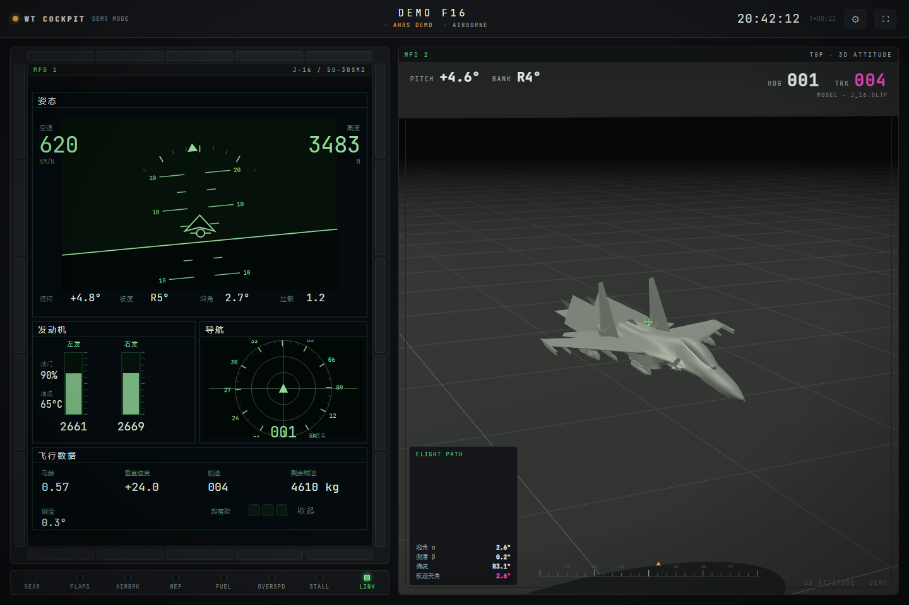

# 空战助手 · KZ Assistant

> **战争雷霆（War Thunder）副屏 MFD 仪表盘 —— 开源项目**

[](LICENSE)
[](LICENSE)
[]()
[]()

**这是一个非商业、参考性质的开源项目。**

- ✅ 免费使用、可读可改可学习
- ❌ **不盈利**：无广告、无付费版、无捐赠、无内置遥测
- ❌ **不对任何后果负责**：账号风险、设备问题、数据丢失均由使用者承担
- 📖 **仅供参考与学习**：不是成熟商业产品
- ⚠️ **非官方**：与 Gaijin Entertainment 无任何关系

详细的法律定位、合规边界与作者顾虑请见 **[LEGAL.md](LEGAL.md)**。

---

## 数据来源与合规声明（摘要）

本程序**只读取** War Thunder 自带的本地接口 `http://localhost:8111`（只读 GET），
**不读内存、不注入、不改游戏文件、不接管操作、不做敌情外推**。

- 不包含任何游戏版权素材（机体模型、字体、贴图均未随仓库分发）
- 需要机体模型时，请在你自己的游戏目录内导出，仅限本机自用，请勿分发
- 使用前请自行确认是否符合 Gaijin 的用户协议与当地法律
# 空战助手 v1.0.1 测试版

## v1.4.8 修复：地面 / 水面目标不显示

**两个原因：**

1. **默认过滤关掉了它们**：`fGnd:false`、`fSur:false`，所以地面和水面目标被滤掉。
   → 默认改为三种全开（`fAir/fGnd/fSur` 都是 true）。
2. **分类只用 `type` 判断**：`type==='ground_model'` 才算地面，其余非 aircraft 全算水面。
   而实际接口里地面单位（Artillery / Pillbox / SPAA / MediumTank…）的 `type` 并不总是 `ground_model`，
   于是被误判成"水面"或"飞机"。

**新分类顺序（先 icon，后 type）：**

| 顺序 | 规则 | 结果 |
|---|---|---|
| 1 | icon 含 ship/boat/frigate/destroyer/cruiser/submarine/carrier | SUR |
| 2 | icon 含 tank/spaa/sam/artillery/pillbox/aaa/howitzer/truck/ifv/apc | GND |
| 3 | icon 含 fighter/bomber/attack/interceptor/uav/heli | AIR |
| 4 | icon 含 missile/bomb（且非舰船） | MSL |
| 5 | type = ground_model / ship_model / airfield / bombing_point | GND / SUR / GND |

实测（mock 六目标分别 AIR/GND/SUR）：四种颜色全部出现（红/琥珀/蓝/品红），态势表分类正确。
## v1.4.7 修复：超出量程的目标

| 问题 | 原因 | 修复 |
|---|---|---|
| 超量程目标完全看不到 | 收到面板边缘时用了 `(600-14)/|vx|`（整宽）而不是半宽，且没有 `min(1,…)`，位置被算到画面外 | 改为半宽/半高，并限制 `kk ≤ 1` |
| 超量程目标位置不贴边 | 原先只做面板边缘收拢 | 现在**先归一到坐标轴最外圈（4 单位）**：该点仍在画面内就画在那里（即坐标轴四周），否则再收攏到面板边缘 |

验证（量程 25 km，目标 5 / 30 / 60 / 120 km）：

```
5.0 km  → 框内（正常三角）
30.0 km → 外圈
60.0 km → 外圈
120.0km → 外圈 / 面板边缘
四个标签全部落在面板内（x 333~632，y 431~553）
```

顺带：mock 支持 `?contacts=5,30,60,120` 自定义距离，便于验证。
## v1.4.6 更新

### 1. 平面分量只表示方向

`Vx,y / Vx,z / Vy,z` 三条射线**长度固定 3.6 单位**（与坐标轴同尺度），不再随速度大小变化；
数值（该平面内的速度模）标在箭头尖端旁边。

### 2. 修复距离刻度标错半径（重要）

距离刻度标注写的是 `var r = it[0] / 5;`，而球体用的是 `km2 / UNIT_KM`。
量程 50 km 时刻度应在 1 / 2 / 4 单位半径上，实际却画到了 10 / 20 / 40 单位——**跑到画面外**，
所以看起来"坐标系只有 25 km"、"目标跑到框中间"。已改为 `r = it[0] / UNIT_KM`。

### 3. 静态标签避让

距离刻度、轴刻度统一走 `staticLabel()`：与已放置的标签重叠就跳过，不会互相压字。

实测：文本重叠 **0**，平面分量数值 800 / 61 / 803 与 VEL 803 自洽。
## v1.4.5 更新

| 问题 | 修复 |
|---|---|
| 目标在框内偏中间、看不见外圈 | **缩放改为"整个 4 单位立方体必须完整入画"**：`U = min(水平可用/最大投影, 垂直可用/最大投影)`，实测内容范围 x 90~623 / y 252~785，完全在面板内且水平垂直都居中 |
| 目标标记仍是箭头+短线 | 改为**单一等腰三角形**（长 9px、半宽 5px，非等边），尖头即目标机头方向，无额外短线 |
| 超量程目标 | 判定条件加严：`d > 4.05` 或投影跑出画面 → 一律贴边 |

实测：面板 713×1037，内容边界 x 90~623、y 252~785 → 居中且不越界；4 个目标三角形正常渲染，无报错。
## v1.4.4 更新：目标改为离散箭头

- **去掉**本机→目标的连线（之前会形成一堆从飞机放射出去的线）
- 每个目标在**它自己的位置**画一个**短箭头**（长度固定 0.22 单位），方向 = 目标机头朝向
- 位置点用 2.4px 小圆点标记，箭头长度不再代表距离（距离看标签）
- 超出量程的目标仍是边缘外指三角，**不再连虚线**
## v1.4.3 更新：目标改为箭头

| 项 | 之前 | 现在 |
|---|---|---|
| 量程内目标 | 带高度的圆柱（底面/顶面椭圆 + 母线） | **从本机指向目标的箭头**（末端带箭头，并附一小段目标朝向线） |
| 超量程目标 | 边缘三角 | 边缘外指三角 + **从本机拉出的虚线**，表示"这个方向更远" |

颜色规则不变（MSL 品红 / AIR 红 / GND 琥珀 / SUR 蓝），箭头末端标注真实距离。
## v1.4.2 修复：超出量程的目标被画进坐标系内部

**现象**：坐标系量程 25 km，但有 51 km、56 km 的目标被画在框内。

**根因**：摆放时做了截断

```js
var d = Math.min(4, cc.dist / 1000 / UNIT_KM);   // ← 被夹到 4 单位（= 量程）
```

超过量程的目标全被夹到最外圈，看起来就像"56 km 的目标在 25 km 的框里"。

**修复**：

| 情况 | 现在画法 |
|---|---|
| 目标在量程内 | 正常圆柱 + 距离标签 |
| 目标超出量程 | **贴到面板边缘**画一个**朝外的三角箭头** + 真实距离标签，表示"这个方向、比量程更远" |

不再截断距离，画面上不会出现"跑进框里"的假位置。

实测（量程 5 km）：3.2 / 4.8 km（在框内）画圆柱；8.2 km（超出）画在边缘。
## v1.4.1 更新：目标方位自标定（解决"目标位置不对"）

前面几轮我用固定公式换算方位（`atan2(dx, -dy)`），但 **map_obj 的 x/y 轴向没有官方说明**，
可能是正常、镜像、或交换。固定公式一旦猜错，目标就会出现在错误的方位上。

现在改为**在飞行中自动辨认**：

| 步骤 | 做法 |
|---|---|
| 采样 | 每轮取自机的地图位移方向 `a = atan2(Δx, −Δy)` |
| 候选 | 4 种约定：`A: a`、`B: 360−a`、`C: 180−a`、`D: 180+a` |
| 判据 | 用**罗盘航向**做真值，累计每种候选的误差平方和 |
| 选择 | 样本 >6 后取误差最小者，之后所有目标方位/朝向都套用该变换 |
| 提示 | 3D 视图左下角显示 `方位约定 A/B/C/D` |

自校准需要**飞行中**（>216 km/h）累计约 10 秒。

几何自检（与坐标轴一致性）：
- 目标在正前方 → 落在 **Y 轴**方向上（Y 轴箭头处）
- 正右方 → 落在 **X 轴**方向
- 正上方 → **Z 轴**方向
## v1.4.0 更新

| 项 | 说明 |
|---|---|
| **量程选项增加** | 50/100/200/400 → **15 / 25 / 50 / 75 / 100 / 150 / 200 / 400 km** 八档 |
| **坐标轴距离刻度** | 三轴每 1 单位标注一次距离（如 200 km 量程下轴上依次是 50 / 100 / 150），颜色与对应轴一致 |
| **球上距离** | 三层距离球（量程的 1/4、1/2、整量程）各在四个 45° 方向标注距离 |
| **平面分量改名** | `XOY / XOZ / YOZ` → **`Vx,y` / `Vx,z` / `Vy,z`**（速度在三个坐标平面上的投影，显示该平面内的速度模） |

实测（重置设置后默认 200 km）：

```
刻度球：50 km / 100 km / 200 km
平面分量：Vx,y 805 / Vx,z 61 / Vy,z 808
速度矢量：VEL 808 KM/H
文本重叠：0
```
## v1.3.1 更新：距离量程可切换

设置 →「距离量程」，四档可选：**50 / 100 / 200 / 400 km**（默认 200 km）。

切换后即时生效（无需重启）：

| 量程 | 1 单位 | 三层距离球 | 轴长覆盖 |
|---|---|---|---|
| 50 km | 12.5 km | 12.5 / 25 / 50 km | ±50 km |
| 100 km | 25 km | 25 / 50 / 100 km | ±100 km |
| 200 km | 50 km | 50 / 100 / 200 km | ±200 km |
| 400 km | 100 km | 100 / 200 / 400 km | ±400 km |

实现：轴长固定 4 单位，`UNIT_KM = 量程 / 4`；距离球与刻度标签按 `UNIT_KM × 4` 生成；
敌情圆柱按 `距离 / UNIT_KM` 摆放；量程变化时重绘静态层。

实测三档切换（Chrome headless）：

```
200 km → 50 / 100 / 200 km 刻度
 50 km → 12.5 / 25 / 50 km 刻度
400 km → 100 / 200 / 400 km 刻度
安装版 UI：按钮 [50][100][200][400]，默认选中 200，无报错
```
## v1.3.0 更新

### 1. 分速度改为「坐标平面投影」

不是投影到单轴，而是投影到三个坐标平面：

| 平面 | 含义 | 分量 | 颜色 |
|---|---|---|---|
| **XOY** | 水平面（右 × 机头） | `(X, Y, 0)`，模 = √(X²+Y²) | 青 |
| **XOZ** | 右-垂直面 | `(X, 0, Z)`，模 = √(X²+Z²) | 橙 |
| **YOZ** | 机头-垂直面 | `(0, Y, Z)`，模 = √(Y²+Z²) | 绿 |

三支箭头从原点伸向各平面内的投影点，末端标注该平面内的速度模（如 `XOY 806`），
并用细虚线连到速度矢量尖端，直观显示三平面分量与合矢量关系。

### 2. 坐标系放大到 200 km

| 项 | 旧 | 新 |
|---|---|---|
| 1 单位 | 5 km | **50 km** |
| 距离球 | 5 / 10 km | **50 / 100 / 200 km**（三层） |
| 地面网格 | ±3 单位 | ±4 单位（每格 50 km） |
| 轴长 | X2.0 / Y2.35 / Z1.75 | **X4.0 / Y4.4 / Z3.2**（≈200 km） |
| 单位像素 U | 116~190 | 70~112（让 4 单位铺满） |

实测：`XOY 806 / XOZ 61 / YOZ 808`，`√` 关系自洽；飞机中心与面板半高相差 4px（居中）。
## v1.2.2 修复：3D 视图不居中 / 坐标系没放大

**根因**：投影函数 `pj()` 里写了

```js
function pj(v) {
  var cy = Math.cos(view.yaw), sy = Math.sin(view.yaw);   // ← 遮蔽了画布中心 cy
  ...
  return [cx + ..., cy - ...];                            // 这里的 cy 其实是 cos(yaw) ≈ 1
}
```

局部变量 `cy`（cos yaw）**遮蔽**了外层的画布中心 `cy`，导致所有点都被投影到 y≈1 附近
（画面顶部），看起来就是「飞机不在中间、坐标系没放大」。

**修复**：局部变量改名 `cw/sw`，外层 `cy` 恢复正常。

| 项 | 修复后实测（1312×1170 窗口） |
|---|---|
| 飞机中心 Y | 509 px（面板半高 518 px）→ 居中 ✓ |
| viewBox | `0 0 600 872`（按容器比例自适应） |
| 单位长度 U | `max(116, min(190, VBH×0.21))` → 183（原来固定 96） |

顺带：距离刻度标签移到 45° 方向、静态标签（轴名/刻度）也登记进避让表，
现在动态标签与静态标签**零重叠**。
## v1.2.1 更新

| 项 | 说明 |
|---|---|
| **修复不居中** | SVG 的 `viewBox` 高度改为跟随容器宽高比（`600 × 600·h/w`），不再是固定 600×600 被信箱化；原点垂直居中（`cy = VBH × 0.5`），图例贴底 |
| **坐标系放大** | 单位长度 `U` 随视图高度自适应：`max(116, min(190, VBH×0.21))`；三轴加长到 X 2.0 / Y 2.35 / Z 1.75，箭头与标签同步放大到 15px |
| **分速度改向量** | X/Y/Z 三个分量各自画成**独立箭头**（橙/蓝/绿），从原点沿对应轴伸出，长度与分量大小成正比；再用虚线连到速度矢量尖端，表示合成关系 |
| **分量数值** | 每个分量箭头末端标注数值（`X −6` / `Y +801` / `Z −61`）；分量过小时自动沿轴外推放置，保证 XYZ 三个都能看到 |

自检：`X +0  Y +793  Z −62` 时 `√(0²+793²+62²) ≈ 796`，与 VEL 一致。
## v1.2.0 更新：3D 视图坐标轴 / 速度分量 / 视角控制

| 项 | 说明 |
|---|---|
| **轴标签改 XYZ** | 机体三轴由 `右 / 机头 / 上` 改为 **`X / Y / Z`**（X=右 橙、Y=机头 蓝、Z=上 绿） |
| **速度分量显示** | 速度矢量末端标注总速 `VEL 796 KM/H`，下一行显示三轴分量 `X +0  Y +793  Z −62`；同时从矢量尖端向三个轴画**虚线投影** |
| **视角控制** | 在 3D 视图上**拖动旋转**（水平=绕 Z 轴偏航，垂直=俯仰）、**滚轮缩放**（0.45×~3×）、**双击复位**；光标会变 grab/grabbing |
| 自检 | `√(0² + 793² + 62²) ≈ 796` ✓ 与总速一致 |

实现方式：所有投影点先经视角旋转矩阵，再做斜二测投影；静态层（地格/距离球/机体/轴）在视角变化时重绘。
## v1.1.1 更新：距离小数 + 态势过滤（附 AI 过滤可行性结论）

### 1. 距离显示小数

| 位置 | 格式 |
|---|---|
| 态势面板 | `12.4 km` / `850 m`（千米 1 位小数） |
| 3D 视图标签 | 同上 |
| 未标定 | 前面加 `~`，如 `~12.4 km` |

### 2. 态势过滤（设置 →「态势过滤」）

三个可独立开关的按钮，默认 **只显示飞机/导弹**：

| 按钮 | 过滤的 kind |
|---|---|
| 飞机/导弹（默认开） | `AIR` / `MSL` |
| 地面（默认关） | `GND` |
| 水面（默认关） | `SUR` |

过滤在数据层完成（`V.contacts`），态势面板和 3D 视图同步生效。

### 3. AI 过滤可行性：**不可行**

实测抓取一次完整对局数据（87 个对象），`/map_obj.json` 的字段只有：

```
type, color, color[], blink, icon, icon_bg, sx, sy, ex, ey, x, y, dx, dy
```

**没有 `isPlayer` / `isAI` / `player` 之类的标识**。

颜色分布（实测）：

| 颜色 | 数量 | 主要 icon |
|---|---|---|
| `#f00C00` | 32 | Artillery 16、Pillbox 8、SPAA 8 |
| `#043FFF` | 22 | Artillery 15、SPAA 7 |
| `#174DFF` | 20 | LightTank、MediumTank、**Fighter**、respawn_base |
| `#fa0C00` | 12 | bombing_point、MediumTank、none |
| `#faC81E` | 1 | Player（自机） |

颜色区分的是**敌我 + 兵种**，不是「玩家 vs AI」。
而 `icon` 里 `Fighter`/`Bomber` 既可能是玩家也可能是 AI 飞机，**无法区分**。

**结论**：本接口无法过滤 AI。能做到的只有「按兵种过滤」（飞机 / 地面 / 水面），
这也是本版实现的方案。若要区分 AI，只能读游戏内存——那是作弊路径，本项目不做。
## v1.1.0 修复：距离显示不对

**问题**：态势面板和 3D 视图里的距离数值明显偏大（或偏小）。

**根因**：距离 = `归一化坐标差 × 比例`，而这个比例之前直接用
`map_info.grid_size`（实测约 52719）当「整张地图的米数」——这只是猜的，
`grid_size` 并不是米制尺度，所以换算出来的公里数不可信。

**改为自标定（用自机运动反推尺度）**：

| 步骤 | 做法 |
|---|---|
| 采样 | 每轮地图轮询记录自机归一化坐标，按 ~2 秒窗口取一段 |
| 反推 | `比例 = (真空速 m/s × 窗口秒数) ÷ 归一化位移长度` |
| 平滑 | 指数平滑 0.8/0.2，最多累计 400 次后锁定 |
| 使用 | 距离 = 归一化距离 × 该比例（x/y 共用） |
| 未标定 | 距离前加 `~` 前缀，表示尚未标定 |

只要飞起来（>216 km/h）持续 2 秒，比例就会自动收敛，之后距离转为精确值。

**自检入口**：`window.KZ.mapScale`（米 / 归一化单位）
## v1.0.9 修复：起落架状态进入对局不刷新

**问题**：进入对局后起落架状态仍是上一架飞机 / 停机时的值，不自动更新。

**根因**：

1. 起落架只从 `/indicators` 的 `gears` 读取，**忽略了 `/state` 的 `gear, %`**。
   部分机型/阶段 `/indicators` 不带 `gears`，此时 `V.gear` 保持旧值不动。
2. 分轮起落架要求 `gearsN` 至少有 2 个才采用，单轮机型直接丢弃。
3. 换机型时没有清掉上一架的缓存。

**修复**：

| 项 | 做法 |
|---|---|
| 双数据源 | `indicators.gears` 优先；缺失时回退到 `state['gear, %']` |
| 分轮解析 | 先按 `gears1..gears4`（1 基），再退 `gears0..gears2`（0 基），**1 个也采用** |
| 换机型重置 | 机型变化时清空 `V.gears` / `gearSrc`，并立即取新值 |
| 防陈旧 | 某轮 `indicators` 没给起落架字段时清空分轮缓存，回落到单一百分比 |

**渲染验证**（用 `?gear=` 强制）：

```
gear=1   → DOWN     ✓
gear=0   → UP       ✓
gear=0.5 → TRANSIT  ✓
```
## v1.0.8 修复：后方敌人显示错误

**现象**：目标在正后方时，3D 视图里被画到机头方向；前后颠倒。

**根因**：地图坐标系 **y 轴向下**（屏幕坐标），而方位角计算用了 `atan2(dx, dy)`：

```js
// 错误（少了一个负号）
brg = atan2(dxm,  dym)
```

这相当于把地图沿水平轴做了镜像 → **正前方 ↔ 正后方**对调，左右不变。

对比：航迹（TRK）计算一直用的是 `atan2(ddx, -ddy)`（正确），所以只有方位角是错的，
两者本来就不一致。

**修复**：

```js
brg = atan2(dxm, -dym)          // 方位
dir = atan2(o.dx, -o.dy)        // 目标朝向
```

**自检**（地图 y 向下：北 = −y，东 = +x）：

| 目标方向 | 计算方位 | 期望 |
|---|---|---|
| 正北 | 0° | 0° ✓ |
| 正东 | 90° | 90° ✓ |
| 正南（后方） | 180° | 180° ✓ |
| 正西 | 270° | 270° ✓ |

机体坐标映射（自机朝北时）：`brg=0 → (0,+1) 机头`、`brg=180 → (0,−1) 机尾`、
`brg=90 → (+1,0) 右`、`brg=270 → (−1,0) 左` ✓
## v1.0.7 更新

**计算面板：「转弯半径」→「速度 X/Y/Z」**

| 显示 | 内容 |
|---|---|
| 主值 | 总速（TAS，随公制/英制切换，如 `809 KM/H`） |
| 分量行 | 机体系三轴分量：`X −10   Y +807   Z −59` |

分量定义（机体系）：

```
Y（机头方向） = V · cos(β) · cos(α)
X（右翼方向） = V · sin(β) · cos(α)
Z（机体上方） = −V · sin(α)
```

其中 `α` 迎角、`β` 侧滑角都来自 8111；`X²+Y²+Z² = V²` 可用来自检
（示例：√(10²+807²+59²) ≈ 809 ✓）。

顺带修了发动机面板「百分比标签」与「推力数值」重叠 4px 的问题。
## v1.0.6 修复：续航算错

**问题**：续航显示 52.4 min 明显偏大。

**根因**：原来用的是「EMA 差分 + 无数据时按 `油门 × 2.1 kg/min` 估算」。
那个 2.1 kg/min 是活塞机的量级，喷气机单发实际是 **40~80 kg/min**（高一个数量级），
所以一旦实测没起来，估算值就会把续航放大十几倍。

**改为：对剩余油量做最小二乘求导**

| 项 | 实现 |
|---|---|
| 采样 | 用**未平滑**的 `Mfuel, kg` 原始值，4 Hz 采样，保留最近 20 秒（最多 90 点） |
| 求导 | 对 `(t, fuel)` 做最小二乘拟合，斜率 = kg/s；要求跨度 ≥4 秒、≥4 个点 |
| 换算 | 消耗率 = `-slope × 60`（kg/min） |
| 续航 | `当前油量 ÷ 消耗率`（min） |
| 航程 | `续航 ÷ 60 × 真空速`（km） |
| 无数据时 | 显示「测量中」，**不再编造估算值** |

**自测**：模拟 1162 kg 以 0.5 kg/s 匀速消耗 —— 求导得 `30.00 kg/min`（精确），续航 `38.7 min`（精确 = 1162/30）。
## v1.0.5 修复：启动后 404

**现象**：程序打开后页面显示 `404`。

**根因**：旧版解包逻辑是「先清空 `%LOCALAPPDATA%\空战助手\web`，再直接往里解」。
当上一个实例仍在运行（或其 WebView2 子进程还持有文件句柄）时，`index.html` / `css/` 的覆盖写入会失败，
结果目录里只剩 `fonts/js/models/vendor`，但版本标记照常写入 → 之后每次启动都认为资源是最新的，**永久 404**。

**修复**：

1. 先解包到独立目录 `web.new`，**不与正在运行的实例抢文件**
2. 校验 `web.new\index.html` 与 `web.new\css\panel.css` 都存在，缺失则报错
3. 通过后再换上去（旧目录删不掉就改名挪开）
4. **版本标记最后写**，且启动检查条件改为「标记正确 **且** index.html 存在」，残缺状态会自动重解

已实测：删除 web 目录后重启，22 个文件完整解包，首页标题恢复为 `空战助手 — 战争雷霆副屏仪表`。
## v1.0.4 更新（3D 态势视觉重做）

| 项 | 说明 |
|---|---|
| **5/10 km 改成球** | 每个距离档画成**三个正交大圆**（水平面 / XZ 面 / YZ 面），组成线框球体，不再是平面圆环 |
| **平面标距离** | 地面上 ±X / ±Y 四个方向各标一次 `5 km`、`10 km`，共 8 个刻度 |
| **敌方单位 = 圆柱** | 每个目标画成**有高度的圆柱**（底面 + 顶面椭圆 + 三条母线），高度 0.26 单位（≈1.3 km 视觉高度）；顶面画朝向短线，线端标距离 |
| **本机速度矢量** | 长度随真空速变化（380 km/h ≈ 1 单位，0.55~2.9 单位），方向随机头/迎角/侧滑；**箭头末端标注速度值**，如 `VEL 803 KM/H`（跟随公制/英制） |

> 敌机高度接口不给，圆柱高度是**统一视觉高度**，不代表真实高度差。
## v1.0.3 更新

**模型视图里的敌情：圆点 → 带朝向的线段（XY 平面）**

| 项 | 说明 |
|---|---|
| 位置 | 起点在机体水平面（XY）上的目标位置，按方位角−航向换算 |
| 形状 | 从起点画一条**箭头线段**，长度固定（约 1.8 km 视觉长度） |
| 朝向 | 方向来自 `dx/dy`（接口给出的方向单位向量），经航向修正后投影 |
| 颜色 | MSL 品红 / AIR 红 / GND 琥珀 / SUR 蓝（导弹线更粗） |
| 标注 | 线端标注距离（km/m），起点有 3.6px 小方点 |
| 图例 | 增加 `→ 朝向` 说明 |

> 说明：接口**不提供敌方高度**，所以线段画在水平面上；高度统一视为 z=0，不做任何推断。
## v1.0.2 更新

| 项 | 说明 |
|---|---|
| **发动机台数自动切换** | 改为按 `RPM N` / `throttle N, %` **字段是否存在**统计台数（不再要求转速 > 0），停机坪、僚机、换机型都能正确识别：单发显示「单发」1 根，双发「左发/右发」2 根，多发 `#1…#8` |
| **发动机独立控制** | 逐台读取 `throttle N, %`，每根柱子用自己的油门；面板左侧油门显示为区间（如 `70-100%`）表示左右发不一致 |
| **每台单独百分比** | 每根柱下方显示该台油门百分比，推力也按该台油门单独换算 |
## 换电脑安装：依赖与环境补全

### 依赖清单

| 依赖 | 是否必需 | 常见系统情况 | 缺失时怎么办 |
|---|---|---|---|
| **.NET Framework 4.x** | 必需（程序本体） | Win10/11 自带 4.8 ✅ | Win7 需手动装 4.8（要重启，无法静默补全）。安装程序会检测并警告 |
| **WebView2 运行时** | 内置浏览器必需 | Win11 内置；Win10 多数随 Edge 已装 | 安装程序检测到缺失会显示「装运行时」按钮，**自动下载微软官方引导程序并静默安装**（需联网 + UAC 提权） |
| **Chrome / Edge** | 兜底用 | Win10/11 必有 Edge ✅ | WebView2 缺失时程序自动退化为用系统浏览器打开 |
| **管理员权限** | 不需要 | 装到 `%LOCALAPPDATA%` | — |
| **网络** | 仅自动装 WebView2 时需要 | — | 无网时手动从微软官网下载 Evergreen 引导程序 |

### 安装程序的检查项（v1.0.1 新增）

1. 启动即检测 **.NET Framework 版本**（读注册表 `NDP\v4\Full\Release`）与 **WebView2 版本**，在界面上打勾/警告
2. WebView2 缺失 → 显示「**装运行时**」按钮：
   - 从 `https://go.microsoft.com/fwlink/p/?LinkId=2124703` 下载官方引导程序
   - 以 `/silent /install` 静默安装（会弹 UAC）
   - 装完自动重新检测
3. 若用户选择不装 → 提示「会退化为系统浏览器打开」，确认后仍可继续安装
4. 检测到旧版会自动覆盖安装

### 结论

- **Win10 21H2 / Win11**：什么都不用做，直接装 ✅
- **较老的 Win10**：安装程序可一键补 WebView2 ✅
- **Win7**：需先手动装 .NET Framework 4.8（微软官网，装完重启），再运行安装程序
- **完全离线**：先在有网机器上下载 `MicrosoftEdgeWebview2Setup.exe` 和 `ndp48-x86-x64-allos-enu.exe`，拷过去装
## 签名信息

| 项 | 内容 |
|---|---|
| 签名算法 | Authenticode / RSA-2048 / SHA-256 |
| 证书主体 | `CN=空战助手 测试版, O=KZ Assistant (Test), C=CN` |
| 指纹 | `0F872CA7851E90EE26EB99A56887FAA854D203F8` |
| 有效期 | 2026-11-27 → 2029-11-27 |
| 类型 | **自签名**（测试用，非商业可信证书） |
| 验证状态 | 本机 `Get-AuthenticodeSignature` = **Valid** |

**已签名文件**：`空战助手.exe`、`空战助手_安装程序.exe`
**证书文件**：`sign\空战助手测试签名.cer`（公钥）、`sign\空战助手测试签名.pfx`（私钥，密码 `kz-test-2026`）
**校验和**：`SHA256SUMS.txt`

### 自签名说明

自签名证书**不会被微软 SmartScreen 直接信任**，换到别的电脑上仍会提示「未知发布者」。要让本机或局域网机器信任：

1. 双击 `sign\空战助手测试签名.cer` → 安装证书
2. 存储位置选「**当前用户**」→「**受信任的根证书颁发机构**」
3. 之后 `Get-AuthenticodeSignature` 会显示 Valid，SmartScreen 也不再拦

> **注意**：本项目**不会**把证书装进系统「受信任的根」。因此 `Get-AuthenticodeSignature` 的
> `Status` 会显示 `UnknownError` / `NotTrusted` —— 这表示**签名存在但颁发者未被信任**，
> 属于自签名证书的正常状态；`SignerCertificate` 能读出主体与指纹就说明签名完好。
> 只有当你手动导入 `.cer` 到受信任根之后，状态才会变成 `Valid`。

### 校验方法

```powershell
Get-AuthenticodeSignature .\空战助手.exe | Format-List Status, SignerCertificate
Get-FileHash .\空战助手.exe -Algorithm SHA256
```


> 这是**测试版**（BETA）：功能在快速迭代，接口与界面可能随时变动，遇到问题请记录复现步骤。

## v0.1.7 更新

**底部灯条三语适配**

| 灯 | 中文 | English | Русский |
|---|---|---|---|
| 起落架 | 起落架 | GEAR | ШАССИ |
| 襟翼 | 襟翼 | FLAPS | ЗАКР |
| 减速板 | 减速板 | AIRBRK | ТОРМ |
| 加力 | 加力 | WEP | ФОРС |
| 燃油 | 燃油 | FUEL | ТОПЛ |
| 超速 | 超速 | OVERSPD | СКОР |
| 失速 | 失速 | STALL | СРЫВ |
| 链接 | 链接 | LINK | СВЯЗЬ |

实现方式：`lampDefs()` 每次构建主题时按当前语言取标签，所以切语言后**立即重绘**，无需重启。

实测三语切换：`起落架|襟翼|减速板…` → `GEAR|FLAPS|AIRBRK…` → `ШАССИ|ЗАКР|ТОРМ…`，全部正确。
## v0.1.6 更新

**单发推力改为可按机型自动识别**

| 项 | 说明 |
|---|---|
| 设置入口 | 设置 →「单发推力」：滑块 20–220 kN + 两个按钮「按机型自动 / 手动」 |
| 机型表 | 内置 60+ 机型的单发加力推力（`b_52`→76、`f_16`→76、`su_27`→122、`f_22`→156、`b_17`→18…），按 `/indicators` 的 `type` 前缀匹配 |
| 自动切换 | 上机/换机型时自动套用；一旦手动拖滑块就转为「手动」，不再被覆盖 |
| 面板显示 | 发动机面板底部显示 `台数 × 单发推力`，例如 B-52H：`8 × 76 kN` |

实测（B-52H）：`type=76 kN`、滑块 `76`、面板 `8 × 76 kN`（总推力 608 kN，与真实 B-52H 的 8×75.6 kN 基本一致）。
## v0.1.4 更新

| 项 | 说明 |
|---|---|
| **续航/航程修复** | ① 油耗率增加物理限幅（单台 ≤120 kg/min × 台数），加油/换机时自动清零重算；② 测不到油耗时按 `油门 × 台数` **估算**，并加 `~` 前缀标明是估算值，不再显示 `---` |
| **发动机数量自适应** | 自动识别 **1/2/3/4/5/6/7/8 发**，按台数自动排布（1~2 列、4 台 2×2、6 台 3×2、8 台 4×2），标签 `左发/右发` 或 `#1…#8` |
| **RPM 解析** | 从固定 3 台改为扫描 `RPM 1`…`RPM 8`（实测 B-52H 会返回 8 个 RPM 字段） |

实测（B-52H，8 发）：
```
发动机  #1 110  #2 110 … #8 110
燃油 40,657 kg · 油耗 376.7 kg/min · 续航 107.2 min · 航程 757 km
```
## v0.1.1 修复

- **图例与读数框重叠**：图例在 3D 区左下、读数框（机头/速度/矢量）原本也在左下，压在一起（`SUR 水面` 那行被盖住）。已把读数框改到**右下角**，图例独占左下。
- 实测：读数框 `x=590,y=783`，图例底边 `y=517`，两者**零重叠**。
## v0.1.0 变更

| 项 | 说明 |
|---|---|
| **新增图例** | 3D 坐标系左下角列出颜色说明：`MSL 导弹`（品红）/ `AIR 飞机`（红）/ `GND 地面`（琥珀）/ `SUR 水面`（蓝），并标注 `5 / 10 km` 距离环 |
| **删除航迹面板** | 右侧的 FLIGHT PATH 面板（迎角/侧滑/偏流/航迹夹角）及设置里的开关一并移除；航迹数值仍保留在「飞行数据」行 |
| **版本号** | 2.8.1 → **0.1.0 测试版**（窗口标题、安装程序标题、卸载项均已更新） |
# 空战助手 — 战争雷霆副屏 MFD 仪表盘

一块给《战争雷霆》用的**副屏全屏 MFD 仪表盘**，按现代战机座舱多功能显示器（MFD）的符号语言做：

- **左边**：MFD 屏幕（带 20 个 OSB 软键边框），五种版式可切
  - **俄系/中式 大屏（默认）**：姿态 + 发动机 + 导航 + 飞行数据，J-16 / Su-30SM2 风格，中文标注
  - **美系 MFD（F-15）**：同一套版式，英文标注
  - **战斗机 PFD（F-16）**：空速带 + ADI + 高度带 + 航向带
  - **经典六表**：二战圆表
  - **玻璃座舱**：大数字
- **右边**：3D 机模 + 坡度尺 + FLIGHT PATH 面板（迎角 α、侧滑 β、偏流、航迹夹角）

数据全部来自游戏官方本地接口 `http://localhost:8111`，**只读**。



美系 F-15 版：　F-16 PFD：

---

## 快速开始

**装好的版本（推荐）**

1. 双击 **`空战助手_安装程序.exe`** → 选目录 → 安装
2. 桌面 / 开始菜单出现「空战助手」，双击启动
3. 启动游戏，面板自动连 8111

**不想安装**：直接双击 **`空战助手.exe`**（免安装，单文件运行）。

两个 EXE 都是自包含的：内置网页资源、自带本地服务，**不需要 Python**，只需要系统里有 Chrome 或 Edge。

| 文件 | 用途 |
|---|---|
| `空战助手.exe` | 主程序（单文件，约 1 MB） |
| `空战助手_安装程序.exe` | 安装程序：写快捷方式 + 注册卸载项 |
| `启动面板.bat` / `关闭面板.bat` | 旧的脚本方式（需要 Python 3，开发用） |

**桌面版行为**

- 运行时把网页解包到 `%LOCALAPPDATA%\空战助手\web`，用 Chrome/Edge 的 app 模式在**副屏全屏**打开
- 托盘图标：**打开面板 / 重新解包资源 / 退出**
- 已在运行时再次双击，只会在副屏再开一个面板窗口
- 卸载：`空战助手.exe --uninstall`，或「设置 → 应用 → 空战助手」
- EXE 未做代码签名，首次运行若被 SmartScreen 拦，选「更多信息 → 仍要运行」

**没开游戏先看效果**：装好后在浏览器打开 `http://127.0.0.1:8123/?mock=1`
旧脚本方式：`python -m http.server 8123 --bind 127.0.0.1`

---

## v2.8.1 修复（航程 / 续航 / 航迹 / 加速度 / 剩余功率）

| 问题 | 根因 | 修复 |
|---|---|---|
| 剩余功率、加速度恒为 `+0` | 导数计算要求 `dt > 0.15s`，但函数每帧(16ms)调用一次，整段永远被跳过 | 改为**按 ≥0.25s 的采样窗口**计算，且只在真正计算时推进采样点 |
| 续航、航程显示 `---` | 同上，油耗率从未被算出来 | 同上；油耗率用 Mfuel 差分 + EMA(0.8/0.2) |
| 航迹恒为 `---` | 判定窗口写成 `>800ms`，但地图轮询间隔是 700ms，条件永不成立 | 阈值改为 300ms |

### 实测（游戏运行中）

```
比能量 9303 m (91.2 kJ/kg)
剩余功率 +38 m/s
转弯率 0.5 °/s   转弯半径 35550 m
推力 110 kN      加速度 +0.4 m/s²
续航 31.6 min    航程 576 km
航迹 068         油耗 83.7 kg/min
```
## v2.8.0 更新

**敌情画进 3D 坐标系里**（右侧模型视图）：

- 地面平面上加了 **5 km / 10 km 距离环**（斜二测投影的椭圆环）
- 每个已点亮目标画成**彩色圆点 + 距离标签**：
  - `MSL` 导弹 → 品红（点更大）
  - `AIR` 飞机 → 红
  - `GND` 地面 → 琥珀
  - `SUR` 水面 → 蓝
- 位置按 **方位角 − 航向** 算到机体系，机头始终朝 +Y，所以：
  - 正前方目标 → 点落在机头箭头上
  - 左后方目标 → 点落在左下
- 距离超过 15 km 会贴在 3 单位边界上（标签仍显示真实距离）

数据更新时（每 0.7 s 拉一次地图）自动重绘，不需要动鼠标。
## v2.7.1 更新

**新增「态势」面板**（替代原「能量」），只显示**游戏已经点亮**的目标：

| 显示 | 来源 |
|---|---|
| 类型 AIR / GND / SUR / MSL | `type` + `icon` |
| 方位 ° | 由自机与目标的 `x/y` 差值算 |
| 距离 km/m | 差值 × `map_info.grid_size` |
| 机型名 | `icon`（Fighter / Bomber / IFV / SAM…） |

排序：**导弹 → 飞机 → 地面 → 水面**，同类按距离由近到远，只取前 5 条。

### 合规说明

- 8111 的 `/map_obj.json` **本身没有 `visibility` 字段**（实测该版本只有 `type/color/blink/icon/x/y/dx/dy`），它返回的就是**游戏小地图正在显示的对象** —— 也就是说"点亮"这件事是游戏自己做的，我们只是换了个呈现方式
- 只取**红色（敌方）**对象，自机（黄）与友军（蓝）不计入
- **不做任何外推**：不预测航迹、不给未来位置、不算拦截点
- `MissileDestroyer`（军舰）已排除，不会被误判成导弹
## v2.6.2 修复

| 问题 | 原因 / 修复 |
|---|---|
| 计算面板数值全是 0 | `updateCalc()` 没接到帧循环（之前的插入点被后续改动覆盖掉了）→ 已接上，现在实时计算 |
| 「剩余功率」和数值重叠 | 标签在左、数值改右对齐（x=566），并加了中心刻度线 |
| 转弯半径显示 `---` | 直线平飞时 √(n²−1)≈0 → 改为显示 **∞**（速度 <5 时仍显示 `---`） |
| 数值跳动 | 剩余功率、加速度、油耗率都加了 EMA 平滑（0.65/0.35、0.85/0.15） |

自检：用 `getBBox()` 做全量文字碰撞检测，宽屏版式下**无重叠**。
## v2.6.0 更新

**取消**左侧 MFD 的「姿态」和「导航」两块，换成**计算**与**能量**：

| 面板 | 内容 |
|---|---|
| **计算**（顶部大块） | 比能量 Es (m)、剩余功率 Ps (m/s)、转弯率 (°/s)、转弯半径 (m)、推力 (kN)、加速度 (m/s²)、续航 (min)、航程 (km) |
| **能量**（中部右） | 比能量竖向能量条 + 剩余功率横条（正绿负琥珀） |
| 发动机（左下） | 保留：左发/右发、油门柱、推力 kN |
| 飞行数据（底部） | 保留：马赫、垂直速度、航迹、剩余燃油、侧滑、起落架 |

### 计算依据（全部来自 8111 公开数据，合规）

| 量 | 公式 |
|---|---|
| 比能量 | `Es = H + V²/(2g)` |
| 剩余功率 | `Ps = dEs/dt`（滑窗差分） |
| 转弯率 | `ω = g·√(n²−1)/V` |
| 转弯半径 | `R = V² / (g·√(n²−1))` |
| 推力 | `油门% × 单发最大推力`（加力 ×1.15） |
| 加速度 | `dV(TAS)/dt` |
| 续航 | `Mfuel / 油耗率`（油耗率由 Mfuel 差分得到） |
| 航程 | `续航 × TAS` |

姿态显示仍保留在右侧（斜二测坐标系/姿态球可切）。
## v2.5.0 更新

- **视角固定在第 IV 卦限**（观察者位于 x>0, y<0, z>0）：
  - +X 向右
  - +Z 向上
  - **+Y 向后**（屏幕上向左上 45°，长度减半）
- 投影函数标在画面左上角：
  `f(x,y,z) = (x − 0.354y,  z + 0.354y)`
## v2.4.1 更新

| 项 | 说明 |
|---|---|
| **以机身为参考系** | 机头方向**固定在屏幕上**，不再随机体转；改为**世界轴随机体姿态反向旋转**，这样「飞机不动、天地动」，读数更直观 |
| **原点改为小飞机** | 原点不再是一个圆点，而是**小型机体模型**：机身 + 机翼 + 平尾 + 竖起的垂尾 + 座舱，用斜二测投影画出，向机头（45°）方向延伸 |
| **机体轴标注** | 固定三轴：**右**（橙）/ **机头**（蓝）/ **上**（绿） |
| **世界轴** | X(红) / Y(蓝) / Z(绿) 虚线，随俯仰、坡度、航向实时反向旋转 |
| **速度矢量** | 品红 **VEL**，按迎角下偏、侧滑偏转，与机头夹角的直观可视化 |
## v2.3.0 更新

| 项 | 说明 |
|---|---|
| **斜二测坐标系** | 右侧改成**斜二测（oblique dimetric）**投影的 2D 图：X 轴水平、Z 轴垂直、Y 轴 45° 且长度取一半（系数 0.3536），不再是透视 3D |
| **世界轴 + 机体轴** | 灰色地格作参考；世界轴 X(红)/Y(蓝)/Z(绿)；机体轴按俯仰/坡度/航向实时旋转，机头 **NOSE**（白）与速度矢量 **VEL**（品红，按迎角下偏、侧滑偏转）分色标出 |
| **数值标注** | 左下读数块：机头 航向/俯仰、速度/马赫、矢量 航迹/迎角 |
| **三视图可切** | 设置 →「3D 机模」：**坐标系**（默认）/ 姿态球 / 3D 模型 |
| **性能** | 姿态变化 <0.3° 且未过 80ms 时不重绘，避免每帧重建 DOM |
## v2.2.0 更新

| 项 | 说明 |
|---|---|
| **导航回退到 1.2 罗盘** | 撤销球面经纬网，恢复三同心圆罗盘 + 刻度环；**数字保持水平**（每帧重算坐标、不随盘旋转），航向读数在盘下方 |
| **发动机→推力** | 标签固定 **左发 / 右发**；柱体上方数字改为**推力 kN**（= 油门% × 单发最大推力，加力时 ×1.15，默认 110 kN），柱体仍表示油门位置 |
| **3D 坐标系标注参数** | 新增白色 **NOSE** 箭头（机头指向）与品红 **VEL** 箭头（速度矢量，按迎角/侧滑偏转）；左下角读数块实时显示 **机头 航向/俯仰、速度/马赫、矢量 航迹/迎角** |
## v2.1.1 修复

- **修复安装失败**：安装程序里 `Name` 常量被 WinForms 的 `Control.Name` 遮蔽，导致路径算成 `...\Programs\.exe` 而报「安装后找不到主程序」。已改名 `AppName`，路径恢复正常。
- **新增静默模式**（便于批处理/自检）：`空战助手_安装程序.exe --silent <目录>`、`--silent-uninstall`，结果写 `%TEMP%\kz_setup.log`。
- **本机已装好**：`C:\Users\wwb22\AppData\Local\Programs\空战助手`（v2.1.1，1.9 MB），桌面 / 开始菜单快捷方式、卸载项齐全。
## v2.1.0 更新

| 项 | 说明 |
|---|---|
| **界面回到 1.x** | 撤销 v2.0 的圆形设计：面板恢复方角、姿态仪恢复**矩形**（俯仰梯 ±60° 保留）、发动机恢复**柱状油门条**（0–110%，100% 加力刻度 + AB 标记保留） |
| **3D 区保留坐标系** | 空间直角坐标系（世界轴 + 机体轴）继续保留，可拖动旋转 / 滚轮缩放 / 双击复位 |
| **内置内核不变** | 仍是 WebView2 内嵌，不依赖外部浏览器 |
| **安装程序升级** | ①启动即检测已装版本并显示路径/版本，按钮变「覆盖安装」<br>②安装前检查 WebView2 运行时、磁盘剩余空间（≥32 MB）、目录可写性<br>③自动结束正在运行的实例再覆盖<br>④提供「卸载旧版」按钮<br>⑤写入 EstimatedSize / InstallDate，可在「设置→应用」正常卸载 |
| **清理旧安装** | 已删除本机旧的 v1.0.4：程序目录、桌面/开始菜单快捷方式、卸载注册表项、`%LOCALAPPDATA%\空战助手` 数据目录 |
## v2.0 更新

| 项 | 说明 |
|---|---|
| **内置浏览器内核** | 打包 WebView2（Chromium）宿主，**不再依赖 Chrome/Edge**，双击即开，无需装浏览器；运行时只需系统自带的 WebView2 Runtime（Win10 21H2+ / Win11 默认就有） |
| **界面改圆形** | 姿态仪改成**大圆表**（r=152，俯仰梯 ±60°），发动机改成**双环形表**（0–110%，100% 处有加力刻度线，超 100% 变琥珀色），面板边框改大圆角 |
| **3D 空间直角坐标系** | 3D 视图里去掉飞机模型，改成**世界坐标轴（X/Y/Z 灰线带标签）+ 机体坐标轴（红 X / 绿 Y / 蓝 Z 箭头）**，随机体俯仰/坡度/航向实时转动，原点有小球和机体示意 |
| **文件组成** | `空战助手.exe` + 3 个 DLL（WebView2 内核）放同一目录；安装程序会自动装全套 |

> 说明：3D 视图仍保留「拖动旋转 / 滚轮缩放 / 双击复位」，坐标系就是在这个自由视角里转的。
> 想换回机模：设置 →「3D 机模」→ 仍可加载自定义 glTF，会替换坐标系显示。
## v1.4.8 修复：地面 / 水面目标不显示

**两个原因：**

1. **默认过滤关掉了它们**：`fGnd:false`、`fSur:false`，所以地面和水面目标被滤掉。
   → 默认改为三种全开（`fAir/fGnd/fSur` 都是 true）。
2. **分类只用 `type` 判断**：`type==='ground_model'` 才算地面，其余非 aircraft 全算水面。
   而实际接口里地面单位（Artillery / Pillbox / SPAA / MediumTank…）的 `type` 并不总是 `ground_model`，
   于是被误判成"水面"或"飞机"。

**新分类顺序（先 icon，后 type）：**

| 顺序 | 规则 | 结果 |
|---|---|---|
| 1 | icon 含 ship/boat/frigate/destroyer/cruiser/submarine/carrier | SUR |
| 2 | icon 含 tank/spaa/sam/artillery/pillbox/aaa/howitzer/truck/ifv/apc | GND |
| 3 | icon 含 fighter/bomber/attack/interceptor/uav/heli | AIR |
| 4 | icon 含 missile/bomb（且非舰船） | MSL |
| 5 | type = ground_model / ship_model / airfield / bombing_point | GND / SUR / GND |

实测（mock 六目标分别 AIR/GND/SUR）：四种颜色全部出现（红/琥珀/蓝/品红），态势表分类正确。
## v1.4.7 修复：超出量程的目标

| 问题 | 原因 | 修复 |
|---|---|---|
| 超量程目标完全看不到 | 收到面板边缘时用了 `(600-14)/|vx|`（整宽）而不是半宽，且没有 `min(1,…)`，位置被算到画面外 | 改为半宽/半高，并限制 `kk ≤ 1` |
| 超量程目标位置不贴边 | 原先只做面板边缘收拢 | 现在**先归一到坐标轴最外圈（4 单位）**：该点仍在画面内就画在那里（即坐标轴四周），否则再收攏到面板边缘 |

验证（量程 25 km，目标 5 / 30 / 60 / 120 km）：

```
5.0 km  → 框内（正常三角）
30.0 km → 外圈
60.0 km → 外圈
120.0km → 外圈 / 面板边缘
四个标签全部落在面板内（x 333~632，y 431~553）
```

顺带：mock 支持 `?contacts=5,30,60,120` 自定义距离，便于验证。
## v1.4.6 更新

### 1. 平面分量只表示方向

`Vx,y / Vx,z / Vy,z` 三条射线**长度固定 3.6 单位**（与坐标轴同尺度），不再随速度大小变化；
数值（该平面内的速度模）标在箭头尖端旁边。

### 2. 修复距离刻度标错半径（重要）

距离刻度标注写的是 `var r = it[0] / 5;`，而球体用的是 `km2 / UNIT_KM`。
量程 50 km 时刻度应在 1 / 2 / 4 单位半径上，实际却画到了 10 / 20 / 40 单位——**跑到画面外**，
所以看起来"坐标系只有 25 km"、"目标跑到框中间"。已改为 `r = it[0] / UNIT_KM`。

### 3. 静态标签避让

距离刻度、轴刻度统一走 `staticLabel()`：与已放置的标签重叠就跳过，不会互相压字。

实测：文本重叠 **0**，平面分量数值 800 / 61 / 803 与 VEL 803 自洽。
## v1.4.5 更新

| 问题 | 修复 |
|---|---|
| 目标在框内偏中间、看不见外圈 | **缩放改为"整个 4 单位立方体必须完整入画"**：`U = min(水平可用/最大投影, 垂直可用/最大投影)`，实测内容范围 x 90~623 / y 252~785，完全在面板内且水平垂直都居中 |
| 目标标记仍是箭头+短线 | 改为**单一等腰三角形**（长 9px、半宽 5px，非等边），尖头即目标机头方向，无额外短线 |
| 超量程目标 | 判定条件加严：`d > 4.05` 或投影跑出画面 → 一律贴边 |

实测：面板 713×1037，内容边界 x 90~623、y 252~785 → 居中且不越界；4 个目标三角形正常渲染，无报错。
## v1.4.4 更新：目标改为离散箭头

- **去掉**本机→目标的连线（之前会形成一堆从飞机放射出去的线）
- 每个目标在**它自己的位置**画一个**短箭头**（长度固定 0.22 单位），方向 = 目标机头朝向
- 位置点用 2.4px 小圆点标记，箭头长度不再代表距离（距离看标签）
- 超出量程的目标仍是边缘外指三角，**不再连虚线**
## v1.4.3 更新：目标改为箭头

| 项 | 之前 | 现在 |
|---|---|---|
| 量程内目标 | 带高度的圆柱（底面/顶面椭圆 + 母线） | **从本机指向目标的箭头**（末端带箭头，并附一小段目标朝向线） |
| 超量程目标 | 边缘三角 | 边缘外指三角 + **从本机拉出的虚线**，表示"这个方向更远" |

颜色规则不变（MSL 品红 / AIR 红 / GND 琥珀 / SUR 蓝），箭头末端标注真实距离。
## v1.4.2 修复：超出量程的目标被画进坐标系内部

**现象**：坐标系量程 25 km，但有 51 km、56 km 的目标被画在框内。

**根因**：摆放时做了截断

```js
var d = Math.min(4, cc.dist / 1000 / UNIT_KM);   // ← 被夹到 4 单位（= 量程）
```

超过量程的目标全被夹到最外圈，看起来就像"56 km 的目标在 25 km 的框里"。

**修复**：

| 情况 | 现在画法 |
|---|---|
| 目标在量程内 | 正常圆柱 + 距离标签 |
| 目标超出量程 | **贴到面板边缘**画一个**朝外的三角箭头** + 真实距离标签，表示"这个方向、比量程更远" |

不再截断距离，画面上不会出现"跑进框里"的假位置。

实测（量程 5 km）：3.2 / 4.8 km（在框内）画圆柱；8.2 km（超出）画在边缘。
## v1.4.1 更新：目标方位自标定（解决"目标位置不对"）

前面几轮我用固定公式换算方位（`atan2(dx, -dy)`），但 **map_obj 的 x/y 轴向没有官方说明**，
可能是正常、镜像、或交换。固定公式一旦猜错，目标就会出现在错误的方位上。

现在改为**在飞行中自动辨认**：

| 步骤 | 做法 |
|---|---|
| 采样 | 每轮取自机的地图位移方向 `a = atan2(Δx, −Δy)` |
| 候选 | 4 种约定：`A: a`、`B: 360−a`、`C: 180−a`、`D: 180+a` |
| 判据 | 用**罗盘航向**做真值，累计每种候选的误差平方和 |
| 选择 | 样本 >6 后取误差最小者，之后所有目标方位/朝向都套用该变换 |
| 提示 | 3D 视图左下角显示 `方位约定 A/B/C/D` |

自校准需要**飞行中**（>216 km/h）累计约 10 秒。

几何自检（与坐标轴一致性）：
- 目标在正前方 → 落在 **Y 轴**方向上（Y 轴箭头处）
- 正右方 → 落在 **X 轴**方向
- 正上方 → **Z 轴**方向
## v1.4.0 更新

| 项 | 说明 |
|---|---|
| **量程选项增加** | 50/100/200/400 → **15 / 25 / 50 / 75 / 100 / 150 / 200 / 400 km** 八档 |
| **坐标轴距离刻度** | 三轴每 1 单位标注一次距离（如 200 km 量程下轴上依次是 50 / 100 / 150），颜色与对应轴一致 |
| **球上距离** | 三层距离球（量程的 1/4、1/2、整量程）各在四个 45° 方向标注距离 |
| **平面分量改名** | `XOY / XOZ / YOZ` → **`Vx,y` / `Vx,z` / `Vy,z`**（速度在三个坐标平面上的投影，显示该平面内的速度模） |

实测（重置设置后默认 200 km）：

```
刻度球：50 km / 100 km / 200 km
平面分量：Vx,y 805 / Vx,z 61 / Vy,z 808
速度矢量：VEL 808 KM/H
文本重叠：0
```
## v1.3.1 更新：距离量程可切换

设置 →「距离量程」，四档可选：**50 / 100 / 200 / 400 km**（默认 200 km）。

切换后即时生效（无需重启）：

| 量程 | 1 单位 | 三层距离球 | 轴长覆盖 |
|---|---|---|---|
| 50 km | 12.5 km | 12.5 / 25 / 50 km | ±50 km |
| 100 km | 25 km | 25 / 50 / 100 km | ±100 km |
| 200 km | 50 km | 50 / 100 / 200 km | ±200 km |
| 400 km | 100 km | 100 / 200 / 400 km | ±400 km |

实现：轴长固定 4 单位，`UNIT_KM = 量程 / 4`；距离球与刻度标签按 `UNIT_KM × 4` 生成；
敌情圆柱按 `距离 / UNIT_KM` 摆放；量程变化时重绘静态层。

实测三档切换（Chrome headless）：

```
200 km → 50 / 100 / 200 km 刻度
 50 km → 12.5 / 25 / 50 km 刻度
400 km → 100 / 200 / 400 km 刻度
安装版 UI：按钮 [50][100][200][400]，默认选中 200，无报错
```
## v1.3.0 更新

### 1. 分速度改为「坐标平面投影」

不是投影到单轴，而是投影到三个坐标平面：

| 平面 | 含义 | 分量 | 颜色 |
|---|---|---|---|
| **XOY** | 水平面（右 × 机头） | `(X, Y, 0)`，模 = √(X²+Y²) | 青 |
| **XOZ** | 右-垂直面 | `(X, 0, Z)`，模 = √(X²+Z²) | 橙 |
| **YOZ** | 机头-垂直面 | `(0, Y, Z)`，模 = √(Y²+Z²) | 绿 |

三支箭头从原点伸向各平面内的投影点，末端标注该平面内的速度模（如 `XOY 806`），
并用细虚线连到速度矢量尖端，直观显示三平面分量与合矢量关系。

### 2. 坐标系放大到 200 km

| 项 | 旧 | 新 |
|---|---|---|
| 1 单位 | 5 km | **50 km** |
| 距离球 | 5 / 10 km | **50 / 100 / 200 km**（三层） |
| 地面网格 | ±3 单位 | ±4 单位（每格 50 km） |
| 轴长 | X2.0 / Y2.35 / Z1.75 | **X4.0 / Y4.4 / Z3.2**（≈200 km） |
| 单位像素 U | 116~190 | 70~112（让 4 单位铺满） |

实测：`XOY 806 / XOZ 61 / YOZ 808`，`√` 关系自洽；飞机中心与面板半高相差 4px（居中）。
## v1.2.2 修复：3D 视图不居中 / 坐标系没放大

**根因**：投影函数 `pj()` 里写了

```js
function pj(v) {
  var cy = Math.cos(view.yaw), sy = Math.sin(view.yaw);   // ← 遮蔽了画布中心 cy
  ...
  return [cx + ..., cy - ...];                            // 这里的 cy 其实是 cos(yaw) ≈ 1
}
```

局部变量 `cy`（cos yaw）**遮蔽**了外层的画布中心 `cy`，导致所有点都被投影到 y≈1 附近
（画面顶部），看起来就是「飞机不在中间、坐标系没放大」。

**修复**：局部变量改名 `cw/sw`，外层 `cy` 恢复正常。

| 项 | 修复后实测（1312×1170 窗口） |
|---|---|
| 飞机中心 Y | 509 px（面板半高 518 px）→ 居中 ✓ |
| viewBox | `0 0 600 872`（按容器比例自适应） |
| 单位长度 U | `max(116, min(190, VBH×0.21))` → 183（原来固定 96） |

顺带：距离刻度标签移到 45° 方向、静态标签（轴名/刻度）也登记进避让表，
现在动态标签与静态标签**零重叠**。
## v1.2.1 更新

| 项 | 说明 |
|---|---|
| **修复不居中** | SVG 的 `viewBox` 高度改为跟随容器宽高比（`600 × 600·h/w`），不再是固定 600×600 被信箱化；原点垂直居中（`cy = VBH × 0.5`），图例贴底 |
| **坐标系放大** | 单位长度 `U` 随视图高度自适应：`max(116, min(190, VBH×0.21))`；三轴加长到 X 2.0 / Y 2.35 / Z 1.75，箭头与标签同步放大到 15px |
| **分速度改向量** | X/Y/Z 三个分量各自画成**独立箭头**（橙/蓝/绿），从原点沿对应轴伸出，长度与分量大小成正比；再用虚线连到速度矢量尖端，表示合成关系 |
| **分量数值** | 每个分量箭头末端标注数值（`X −6` / `Y +801` / `Z −61`）；分量过小时自动沿轴外推放置，保证 XYZ 三个都能看到 |

自检：`X +0  Y +793  Z −62` 时 `√(0²+793²+62²) ≈ 796`，与 VEL 一致。
## v1.2.0 更新：3D 视图坐标轴 / 速度分量 / 视角控制

| 项 | 说明 |
|---|---|
| **轴标签改 XYZ** | 机体三轴由 `右 / 机头 / 上` 改为 **`X / Y / Z`**（X=右 橙、Y=机头 蓝、Z=上 绿） |
| **速度分量显示** | 速度矢量末端标注总速 `VEL 796 KM/H`，下一行显示三轴分量 `X +0  Y +793  Z −62`；同时从矢量尖端向三个轴画**虚线投影** |
| **视角控制** | 在 3D 视图上**拖动旋转**（水平=绕 Z 轴偏航，垂直=俯仰）、**滚轮缩放**（0.45×~3×）、**双击复位**；光标会变 grab/grabbing |
| 自检 | `√(0² + 793² + 62²) ≈ 796` ✓ 与总速一致 |

实现方式：所有投影点先经视角旋转矩阵，再做斜二测投影；静态层（地格/距离球/机体/轴）在视角变化时重绘。
## v1.1.1 更新：距离小数 + 态势过滤（附 AI 过滤可行性结论）

### 1. 距离显示小数

| 位置 | 格式 |
|---|---|
| 态势面板 | `12.4 km` / `850 m`（千米 1 位小数） |
| 3D 视图标签 | 同上 |
| 未标定 | 前面加 `~`，如 `~12.4 km` |

### 2. 态势过滤（设置 →「态势过滤」）

三个可独立开关的按钮，默认 **只显示飞机/导弹**：

| 按钮 | 过滤的 kind |
|---|---|
| 飞机/导弹（默认开） | `AIR` / `MSL` |
| 地面（默认关） | `GND` |
| 水面（默认关） | `SUR` |

过滤在数据层完成（`V.contacts`），态势面板和 3D 视图同步生效。

### 3. AI 过滤可行性：**不可行**

实测抓取一次完整对局数据（87 个对象），`/map_obj.json` 的字段只有：

```
type, color, color[], blink, icon, icon_bg, sx, sy, ex, ey, x, y, dx, dy
```

**没有 `isPlayer` / `isAI` / `player` 之类的标识**。

颜色分布（实测）：

| 颜色 | 数量 | 主要 icon |
|---|---|---|
| `#f00C00` | 32 | Artillery 16、Pillbox 8、SPAA 8 |
| `#043FFF` | 22 | Artillery 15、SPAA 7 |
| `#174DFF` | 20 | LightTank、MediumTank、**Fighter**、respawn_base |
| `#fa0C00` | 12 | bombing_point、MediumTank、none |
| `#faC81E` | 1 | Player（自机） |

颜色区分的是**敌我 + 兵种**，不是「玩家 vs AI」。
而 `icon` 里 `Fighter`/`Bomber` 既可能是玩家也可能是 AI 飞机，**无法区分**。

**结论**：本接口无法过滤 AI。能做到的只有「按兵种过滤」（飞机 / 地面 / 水面），
这也是本版实现的方案。若要区分 AI，只能读游戏内存——那是作弊路径，本项目不做。
## v1.1.0 修复：距离显示不对

**问题**：态势面板和 3D 视图里的距离数值明显偏大（或偏小）。

**根因**：距离 = `归一化坐标差 × 比例`，而这个比例之前直接用
`map_info.grid_size`（实测约 52719）当「整张地图的米数」——这只是猜的，
`grid_size` 并不是米制尺度，所以换算出来的公里数不可信。

**改为自标定（用自机运动反推尺度）**：

| 步骤 | 做法 |
|---|---|
| 采样 | 每轮地图轮询记录自机归一化坐标，按 ~2 秒窗口取一段 |
| 反推 | `比例 = (真空速 m/s × 窗口秒数) ÷ 归一化位移长度` |
| 平滑 | 指数平滑 0.8/0.2，最多累计 400 次后锁定 |
| 使用 | 距离 = 归一化距离 × 该比例（x/y 共用） |
| 未标定 | 距离前加 `~` 前缀，表示尚未标定 |

只要飞起来（>216 km/h）持续 2 秒，比例就会自动收敛，之后距离转为精确值。

**自检入口**：`window.KZ.mapScale`（米 / 归一化单位）
## v1.0.9 修复：起落架状态进入对局不刷新

**问题**：进入对局后起落架状态仍是上一架飞机 / 停机时的值，不自动更新。

**根因**：

1. 起落架只从 `/indicators` 的 `gears` 读取，**忽略了 `/state` 的 `gear, %`**。
   部分机型/阶段 `/indicators` 不带 `gears`，此时 `V.gear` 保持旧值不动。
2. 分轮起落架要求 `gearsN` 至少有 2 个才采用，单轮机型直接丢弃。
3. 换机型时没有清掉上一架的缓存。

**修复**：

| 项 | 做法 |
|---|---|
| 双数据源 | `indicators.gears` 优先；缺失时回退到 `state['gear, %']` |
| 分轮解析 | 先按 `gears1..gears4`（1 基），再退 `gears0..gears2`（0 基），**1 个也采用** |
| 换机型重置 | 机型变化时清空 `V.gears` / `gearSrc`，并立即取新值 |
| 防陈旧 | 某轮 `indicators` 没给起落架字段时清空分轮缓存，回落到单一百分比 |

**渲染验证**（用 `?gear=` 强制）：

```
gear=1   → DOWN     ✓
gear=0   → UP       ✓
gear=0.5 → TRANSIT  ✓
```
## v1.0.8 修复：后方敌人显示错误

**现象**：目标在正后方时，3D 视图里被画到机头方向；前后颠倒。

**根因**：地图坐标系 **y 轴向下**（屏幕坐标），而方位角计算用了 `atan2(dx, dy)`：

```js
// 错误（少了一个负号）
brg = atan2(dxm,  dym)
```

这相当于把地图沿水平轴做了镜像 → **正前方 ↔ 正后方**对调，左右不变。

对比：航迹（TRK）计算一直用的是 `atan2(ddx, -ddy)`（正确），所以只有方位角是错的，
两者本来就不一致。

**修复**：

```js
brg = atan2(dxm, -dym)          // 方位
dir = atan2(o.dx, -o.dy)        // 目标朝向
```

**自检**（地图 y 向下：北 = −y，东 = +x）：

| 目标方向 | 计算方位 | 期望 |
|---|---|---|
| 正北 | 0° | 0° ✓ |
| 正东 | 90° | 90° ✓ |
| 正南（后方） | 180° | 180° ✓ |
| 正西 | 270° | 270° ✓ |

机体坐标映射（自机朝北时）：`brg=0 → (0,+1) 机头`、`brg=180 → (0,−1) 机尾`、
`brg=90 → (+1,0) 右`、`brg=270 → (−1,0) 左` ✓
## v1.0.7 更新

**计算面板：「转弯半径」→「速度 X/Y/Z」**

| 显示 | 内容 |
|---|---|
| 主值 | 总速（TAS，随公制/英制切换，如 `809 KM/H`） |
| 分量行 | 机体系三轴分量：`X −10   Y +807   Z −59` |

分量定义（机体系）：

```
Y（机头方向） = V · cos(β) · cos(α)
X（右翼方向） = V · sin(β) · cos(α)
Z（机体上方） = −V · sin(α)
```

其中 `α` 迎角、`β` 侧滑角都来自 8111；`X²+Y²+Z² = V²` 可用来自检
（示例：√(10²+807²+59²) ≈ 809 ✓）。

顺带修了发动机面板「百分比标签」与「推力数值」重叠 4px 的问题。
## v1.0.6 修复：续航算错

**问题**：续航显示 52.4 min 明显偏大。

**根因**：原来用的是「EMA 差分 + 无数据时按 `油门 × 2.1 kg/min` 估算」。
那个 2.1 kg/min 是活塞机的量级，喷气机单发实际是 **40~80 kg/min**（高一个数量级），
所以一旦实测没起来，估算值就会把续航放大十几倍。

**改为：对剩余油量做最小二乘求导**

| 项 | 实现 |
|---|---|
| 采样 | 用**未平滑**的 `Mfuel, kg` 原始值，4 Hz 采样，保留最近 20 秒（最多 90 点） |
| 求导 | 对 `(t, fuel)` 做最小二乘拟合，斜率 = kg/s；要求跨度 ≥4 秒、≥4 个点 |
| 换算 | 消耗率 = `-slope × 60`（kg/min） |
| 续航 | `当前油量 ÷ 消耗率`（min） |
| 航程 | `续航 ÷ 60 × 真空速`（km） |
| 无数据时 | 显示「测量中」，**不再编造估算值** |

**自测**：模拟 1162 kg 以 0.5 kg/s 匀速消耗 —— 求导得 `30.00 kg/min`（精确），续航 `38.7 min`（精确 = 1162/30）。
## v1.0.5 修复：启动后 404

**现象**：程序打开后页面显示 `404`。

**根因**：旧版解包逻辑是「先清空 `%LOCALAPPDATA%\空战助手\web`，再直接往里解」。
当上一个实例仍在运行（或其 WebView2 子进程还持有文件句柄）时，`index.html` / `css/` 的覆盖写入会失败，
结果目录里只剩 `fonts/js/models/vendor`，但版本标记照常写入 → 之后每次启动都认为资源是最新的，**永久 404**。

**修复**：

1. 先解包到独立目录 `web.new`，**不与正在运行的实例抢文件**
2. 校验 `web.new\index.html` 与 `web.new\css\panel.css` 都存在，缺失则报错
3. 通过后再换上去（旧目录删不掉就改名挪开）
4. **版本标记最后写**，且启动检查条件改为「标记正确 **且** index.html 存在」，残缺状态会自动重解

已实测：删除 web 目录后重启，22 个文件完整解包，首页标题恢复为 `空战助手 — 战争雷霆副屏仪表`。
## v1.0.4 更新

| 项 | 说明 |
|---|---|
| **俯仰范围加大** | 左侧姿态仪俯仰梯从 **±20°** 扩到 **±60°**（每 5° 一根，每 10° 标数）；右侧球 ±45° |
| **自由视角** | 3D 模型视图支持**拖动旋转**（360° 环视）、**滚轮缩放**（0.45×–3×）、**双击复位**；带阻尼插值，不平滑跳变 |
| **复位入口** | 设置 →「3D 机模」下新增 **复位视角** / **重置模型**（朝向、大小归位） |
| **交互优化** | 画布 `grab/grabbing` 光标、触摸屏可拖、相机不会翻到地面以下（俯仰角钳制）、小飞机模式下跳过 3D 渲染省 GPU |
## v1.4.8 修复：地面 / 水面目标不显示

**两个原因：**

1. **默认过滤关掉了它们**：`fGnd:false`、`fSur:false`，所以地面和水面目标被滤掉。
   → 默认改为三种全开（`fAir/fGnd/fSur` 都是 true）。
2. **分类只用 `type` 判断**：`type==='ground_model'` 才算地面，其余非 aircraft 全算水面。
   而实际接口里地面单位（Artillery / Pillbox / SPAA / MediumTank…）的 `type` 并不总是 `ground_model`，
   于是被误判成"水面"或"飞机"。

**新分类顺序（先 icon，后 type）：**

| 顺序 | 规则 | 结果 |
|---|---|---|
| 1 | icon 含 ship/boat/frigate/destroyer/cruiser/submarine/carrier | SUR |
| 2 | icon 含 tank/spaa/sam/artillery/pillbox/aaa/howitzer/truck/ifv/apc | GND |
| 3 | icon 含 fighter/bomber/attack/interceptor/uav/heli | AIR |
| 4 | icon 含 missile/bomb（且非舰船） | MSL |
| 5 | type = ground_model / ship_model / airfield / bombing_point | GND / SUR / GND |

实测（mock 六目标分别 AIR/GND/SUR）：四种颜色全部出现（红/琥珀/蓝/品红），态势表分类正确。
## v1.4.7 修复：超出量程的目标

| 问题 | 原因 | 修复 |
|---|---|---|
| 超量程目标完全看不到 | 收到面板边缘时用了 `(600-14)/|vx|`（整宽）而不是半宽，且没有 `min(1,…)`，位置被算到画面外 | 改为半宽/半高，并限制 `kk ≤ 1` |
| 超量程目标位置不贴边 | 原先只做面板边缘收拢 | 现在**先归一到坐标轴最外圈（4 单位）**：该点仍在画面内就画在那里（即坐标轴四周），否则再收攏到面板边缘 |

验证（量程 25 km，目标 5 / 30 / 60 / 120 km）：

```
5.0 km  → 框内（正常三角）
30.0 km → 外圈
60.0 km → 外圈
120.0km → 外圈 / 面板边缘
四个标签全部落在面板内（x 333~632，y 431~553）
```

顺带：mock 支持 `?contacts=5,30,60,120` 自定义距离，便于验证。
## v1.4.6 更新

### 1. 平面分量只表示方向

`Vx,y / Vx,z / Vy,z` 三条射线**长度固定 3.6 单位**（与坐标轴同尺度），不再随速度大小变化；
数值（该平面内的速度模）标在箭头尖端旁边。

### 2. 修复距离刻度标错半径（重要）

距离刻度标注写的是 `var r = it[0] / 5;`，而球体用的是 `km2 / UNIT_KM`。
量程 50 km 时刻度应在 1 / 2 / 4 单位半径上，实际却画到了 10 / 20 / 40 单位——**跑到画面外**，
所以看起来"坐标系只有 25 km"、"目标跑到框中间"。已改为 `r = it[0] / UNIT_KM`。

### 3. 静态标签避让

距离刻度、轴刻度统一走 `staticLabel()`：与已放置的标签重叠就跳过，不会互相压字。

实测：文本重叠 **0**，平面分量数值 800 / 61 / 803 与 VEL 803 自洽。
## v1.4.5 更新

| 问题 | 修复 |
|---|---|
| 目标在框内偏中间、看不见外圈 | **缩放改为"整个 4 单位立方体必须完整入画"**：`U = min(水平可用/最大投影, 垂直可用/最大投影)`，实测内容范围 x 90~623 / y 252~785，完全在面板内且水平垂直都居中 |
| 目标标记仍是箭头+短线 | 改为**单一等腰三角形**（长 9px、半宽 5px，非等边），尖头即目标机头方向，无额外短线 |
| 超量程目标 | 判定条件加严：`d > 4.05` 或投影跑出画面 → 一律贴边 |

实测：面板 713×1037，内容边界 x 90~623、y 252~785 → 居中且不越界；4 个目标三角形正常渲染，无报错。
## v1.4.4 更新：目标改为离散箭头

- **去掉**本机→目标的连线（之前会形成一堆从飞机放射出去的线）
- 每个目标在**它自己的位置**画一个**短箭头**（长度固定 0.22 单位），方向 = 目标机头朝向
- 位置点用 2.4px 小圆点标记，箭头长度不再代表距离（距离看标签）
- 超出量程的目标仍是边缘外指三角，**不再连虚线**
## v1.4.3 更新：目标改为箭头

| 项 | 之前 | 现在 |
|---|---|---|
| 量程内目标 | 带高度的圆柱（底面/顶面椭圆 + 母线） | **从本机指向目标的箭头**（末端带箭头，并附一小段目标朝向线） |
| 超量程目标 | 边缘三角 | 边缘外指三角 + **从本机拉出的虚线**，表示"这个方向更远" |

颜色规则不变（MSL 品红 / AIR 红 / GND 琥珀 / SUR 蓝），箭头末端标注真实距离。
## v1.4.2 修复：超出量程的目标被画进坐标系内部

**现象**：坐标系量程 25 km，但有 51 km、56 km 的目标被画在框内。

**根因**：摆放时做了截断

```js
var d = Math.min(4, cc.dist / 1000 / UNIT_KM);   // ← 被夹到 4 单位（= 量程）
```

超过量程的目标全被夹到最外圈，看起来就像"56 km 的目标在 25 km 的框里"。

**修复**：

| 情况 | 现在画法 |
|---|---|
| 目标在量程内 | 正常圆柱 + 距离标签 |
| 目标超出量程 | **贴到面板边缘**画一个**朝外的三角箭头** + 真实距离标签，表示"这个方向、比量程更远" |

不再截断距离，画面上不会出现"跑进框里"的假位置。

实测（量程 5 km）：3.2 / 4.8 km（在框内）画圆柱；8.2 km（超出）画在边缘。
## v1.4.1 更新：目标方位自标定（解决"目标位置不对"）

前面几轮我用固定公式换算方位（`atan2(dx, -dy)`），但 **map_obj 的 x/y 轴向没有官方说明**，
可能是正常、镜像、或交换。固定公式一旦猜错，目标就会出现在错误的方位上。

现在改为**在飞行中自动辨认**：

| 步骤 | 做法 |
|---|---|
| 采样 | 每轮取自机的地图位移方向 `a = atan2(Δx, −Δy)` |
| 候选 | 4 种约定：`A: a`、`B: 360−a`、`C: 180−a`、`D: 180+a` |
| 判据 | 用**罗盘航向**做真值，累计每种候选的误差平方和 |
| 选择 | 样本 >6 后取误差最小者，之后所有目标方位/朝向都套用该变换 |
| 提示 | 3D 视图左下角显示 `方位约定 A/B/C/D` |

自校准需要**飞行中**（>216 km/h）累计约 10 秒。

几何自检（与坐标轴一致性）：
- 目标在正前方 → 落在 **Y 轴**方向上（Y 轴箭头处）
- 正右方 → 落在 **X 轴**方向
- 正上方 → **Z 轴**方向
## v1.4.0 更新

| 项 | 说明 |
|---|---|
| **量程选项增加** | 50/100/200/400 → **15 / 25 / 50 / 75 / 100 / 150 / 200 / 400 km** 八档 |
| **坐标轴距离刻度** | 三轴每 1 单位标注一次距离（如 200 km 量程下轴上依次是 50 / 100 / 150），颜色与对应轴一致 |
| **球上距离** | 三层距离球（量程的 1/4、1/2、整量程）各在四个 45° 方向标注距离 |
| **平面分量改名** | `XOY / XOZ / YOZ` → **`Vx,y` / `Vx,z` / `Vy,z`**（速度在三个坐标平面上的投影，显示该平面内的速度模） |

实测（重置设置后默认 200 km）：

```
刻度球：50 km / 100 km / 200 km
平面分量：Vx,y 805 / Vx,z 61 / Vy,z 808
速度矢量：VEL 808 KM/H
文本重叠：0
```
## v1.3.1 更新：距离量程可切换

设置 →「距离量程」，四档可选：**50 / 100 / 200 / 400 km**（默认 200 km）。

切换后即时生效（无需重启）：

| 量程 | 1 单位 | 三层距离球 | 轴长覆盖 |
|---|---|---|---|
| 50 km | 12.5 km | 12.5 / 25 / 50 km | ±50 km |
| 100 km | 25 km | 25 / 50 / 100 km | ±100 km |
| 200 km | 50 km | 50 / 100 / 200 km | ±200 km |
| 400 km | 100 km | 100 / 200 / 400 km | ±400 km |

实现：轴长固定 4 单位，`UNIT_KM = 量程 / 4`；距离球与刻度标签按 `UNIT_KM × 4` 生成；
敌情圆柱按 `距离 / UNIT_KM` 摆放；量程变化时重绘静态层。

实测三档切换（Chrome headless）：

```
200 km → 50 / 100 / 200 km 刻度
 50 km → 12.5 / 25 / 50 km 刻度
400 km → 100 / 200 / 400 km 刻度
安装版 UI：按钮 [50][100][200][400]，默认选中 200，无报错
```
## v1.3.0 更新

### 1. 分速度改为「坐标平面投影」

不是投影到单轴，而是投影到三个坐标平面：

| 平面 | 含义 | 分量 | 颜色 |
|---|---|---|---|
| **XOY** | 水平面（右 × 机头） | `(X, Y, 0)`，模 = √(X²+Y²) | 青 |
| **XOZ** | 右-垂直面 | `(X, 0, Z)`，模 = √(X²+Z²) | 橙 |
| **YOZ** | 机头-垂直面 | `(0, Y, Z)`，模 = √(Y²+Z²) | 绿 |

三支箭头从原点伸向各平面内的投影点，末端标注该平面内的速度模（如 `XOY 806`），
并用细虚线连到速度矢量尖端，直观显示三平面分量与合矢量关系。

### 2. 坐标系放大到 200 km

| 项 | 旧 | 新 |
|---|---|---|
| 1 单位 | 5 km | **50 km** |
| 距离球 | 5 / 10 km | **50 / 100 / 200 km**（三层） |
| 地面网格 | ±3 单位 | ±4 单位（每格 50 km） |
| 轴长 | X2.0 / Y2.35 / Z1.75 | **X4.0 / Y4.4 / Z3.2**（≈200 km） |
| 单位像素 U | 116~190 | 70~112（让 4 单位铺满） |

实测：`XOY 806 / XOZ 61 / YOZ 808`，`√` 关系自洽；飞机中心与面板半高相差 4px（居中）。
## v1.2.2 修复：3D 视图不居中 / 坐标系没放大

**根因**：投影函数 `pj()` 里写了

```js
function pj(v) {
  var cy = Math.cos(view.yaw), sy = Math.sin(view.yaw);   // ← 遮蔽了画布中心 cy
  ...
  return [cx + ..., cy - ...];                            // 这里的 cy 其实是 cos(yaw) ≈ 1
}
```

局部变量 `cy`（cos yaw）**遮蔽**了外层的画布中心 `cy`，导致所有点都被投影到 y≈1 附近
（画面顶部），看起来就是「飞机不在中间、坐标系没放大」。

**修复**：局部变量改名 `cw/sw`，外层 `cy` 恢复正常。

| 项 | 修复后实测（1312×1170 窗口） |
|---|---|
| 飞机中心 Y | 509 px（面板半高 518 px）→ 居中 ✓ |
| viewBox | `0 0 600 872`（按容器比例自适应） |
| 单位长度 U | `max(116, min(190, VBH×0.21))` → 183（原来固定 96） |

顺带：距离刻度标签移到 45° 方向、静态标签（轴名/刻度）也登记进避让表，
现在动态标签与静态标签**零重叠**。
## v1.2.1 更新

| 项 | 说明 |
|---|---|
| **修复不居中** | SVG 的 `viewBox` 高度改为跟随容器宽高比（`600 × 600·h/w`），不再是固定 600×600 被信箱化；原点垂直居中（`cy = VBH × 0.5`），图例贴底 |
| **坐标系放大** | 单位长度 `U` 随视图高度自适应：`max(116, min(190, VBH×0.21))`；三轴加长到 X 2.0 / Y 2.35 / Z 1.75，箭头与标签同步放大到 15px |
| **分速度改向量** | X/Y/Z 三个分量各自画成**独立箭头**（橙/蓝/绿），从原点沿对应轴伸出，长度与分量大小成正比；再用虚线连到速度矢量尖端，表示合成关系 |
| **分量数值** | 每个分量箭头末端标注数值（`X −6` / `Y +801` / `Z −61`）；分量过小时自动沿轴外推放置，保证 XYZ 三个都能看到 |

自检：`X +0  Y +793  Z −62` 时 `√(0²+793²+62²) ≈ 796`，与 VEL 一致。
## v1.2.0 更新：3D 视图坐标轴 / 速度分量 / 视角控制

| 项 | 说明 |
|---|---|
| **轴标签改 XYZ** | 机体三轴由 `右 / 机头 / 上` 改为 **`X / Y / Z`**（X=右 橙、Y=机头 蓝、Z=上 绿） |
| **速度分量显示** | 速度矢量末端标注总速 `VEL 796 KM/H`，下一行显示三轴分量 `X +0  Y +793  Z −62`；同时从矢量尖端向三个轴画**虚线投影** |
| **视角控制** | 在 3D 视图上**拖动旋转**（水平=绕 Z 轴偏航，垂直=俯仰）、**滚轮缩放**（0.45×~3×）、**双击复位**；光标会变 grab/grabbing |
| 自检 | `√(0² + 793² + 62²) ≈ 796` ✓ 与总速一致 |

实现方式：所有投影点先经视角旋转矩阵，再做斜二测投影；静态层（地格/距离球/机体/轴）在视角变化时重绘。
## v1.1.1 更新：距离小数 + 态势过滤（附 AI 过滤可行性结论）

### 1. 距离显示小数

| 位置 | 格式 |
|---|---|
| 态势面板 | `12.4 km` / `850 m`（千米 1 位小数） |
| 3D 视图标签 | 同上 |
| 未标定 | 前面加 `~`，如 `~12.4 km` |

### 2. 态势过滤（设置 →「态势过滤」）

三个可独立开关的按钮，默认 **只显示飞机/导弹**：

| 按钮 | 过滤的 kind |
|---|---|
| 飞机/导弹（默认开） | `AIR` / `MSL` |
| 地面（默认关） | `GND` |
| 水面（默认关） | `SUR` |

过滤在数据层完成（`V.contacts`），态势面板和 3D 视图同步生效。

### 3. AI 过滤可行性：**不可行**

实测抓取一次完整对局数据（87 个对象），`/map_obj.json` 的字段只有：

```
type, color, color[], blink, icon, icon_bg, sx, sy, ex, ey, x, y, dx, dy
```

**没有 `isPlayer` / `isAI` / `player` 之类的标识**。

颜色分布（实测）：

| 颜色 | 数量 | 主要 icon |
|---|---|---|
| `#f00C00` | 32 | Artillery 16、Pillbox 8、SPAA 8 |
| `#043FFF` | 22 | Artillery 15、SPAA 7 |
| `#174DFF` | 20 | LightTank、MediumTank、**Fighter**、respawn_base |
| `#fa0C00` | 12 | bombing_point、MediumTank、none |
| `#faC81E` | 1 | Player（自机） |

颜色区分的是**敌我 + 兵种**，不是「玩家 vs AI」。
而 `icon` 里 `Fighter`/`Bomber` 既可能是玩家也可能是 AI 飞机，**无法区分**。

**结论**：本接口无法过滤 AI。能做到的只有「按兵种过滤」（飞机 / 地面 / 水面），
这也是本版实现的方案。若要区分 AI，只能读游戏内存——那是作弊路径，本项目不做。
## v1.1.0 修复：距离显示不对

**问题**：态势面板和 3D 视图里的距离数值明显偏大（或偏小）。

**根因**：距离 = `归一化坐标差 × 比例`，而这个比例之前直接用
`map_info.grid_size`（实测约 52719）当「整张地图的米数」——这只是猜的，
`grid_size` 并不是米制尺度，所以换算出来的公里数不可信。

**改为自标定（用自机运动反推尺度）**：

| 步骤 | 做法 |
|---|---|
| 采样 | 每轮地图轮询记录自机归一化坐标，按 ~2 秒窗口取一段 |
| 反推 | `比例 = (真空速 m/s × 窗口秒数) ÷ 归一化位移长度` |
| 平滑 | 指数平滑 0.8/0.2，最多累计 400 次后锁定 |
| 使用 | 距离 = 归一化距离 × 该比例（x/y 共用） |
| 未标定 | 距离前加 `~` 前缀，表示尚未标定 |

只要飞起来（>216 km/h）持续 2 秒，比例就会自动收敛，之后距离转为精确值。

**自检入口**：`window.KZ.mapScale`（米 / 归一化单位）
## v1.0.9 修复：起落架状态进入对局不刷新

**问题**：进入对局后起落架状态仍是上一架飞机 / 停机时的值，不自动更新。

**根因**：

1. 起落架只从 `/indicators` 的 `gears` 读取，**忽略了 `/state` 的 `gear, %`**。
   部分机型/阶段 `/indicators` 不带 `gears`，此时 `V.gear` 保持旧值不动。
2. 分轮起落架要求 `gearsN` 至少有 2 个才采用，单轮机型直接丢弃。
3. 换机型时没有清掉上一架的缓存。

**修复**：

| 项 | 做法 |
|---|---|
| 双数据源 | `indicators.gears` 优先；缺失时回退到 `state['gear, %']` |
| 分轮解析 | 先按 `gears1..gears4`（1 基），再退 `gears0..gears2`（0 基），**1 个也采用** |
| 换机型重置 | 机型变化时清空 `V.gears` / `gearSrc`，并立即取新值 |
| 防陈旧 | 某轮 `indicators` 没给起落架字段时清空分轮缓存，回落到单一百分比 |

**渲染验证**（用 `?gear=` 强制）：

```
gear=1   → DOWN     ✓
gear=0   → UP       ✓
gear=0.5 → TRANSIT  ✓
```
## v1.0.8 修复：后方敌人显示错误

**现象**：目标在正后方时，3D 视图里被画到机头方向；前后颠倒。

**根因**：地图坐标系 **y 轴向下**（屏幕坐标），而方位角计算用了 `atan2(dx, dy)`：

```js
// 错误（少了一个负号）
brg = atan2(dxm,  dym)
```

这相当于把地图沿水平轴做了镜像 → **正前方 ↔ 正后方**对调，左右不变。

对比：航迹（TRK）计算一直用的是 `atan2(ddx, -ddy)`（正确），所以只有方位角是错的，
两者本来就不一致。

**修复**：

```js
brg = atan2(dxm, -dym)          // 方位
dir = atan2(o.dx, -o.dy)        // 目标朝向
```

**自检**（地图 y 向下：北 = −y，东 = +x）：

| 目标方向 | 计算方位 | 期望 |
|---|---|---|
| 正北 | 0° | 0° ✓ |
| 正东 | 90° | 90° ✓ |
| 正南（后方） | 180° | 180° ✓ |
| 正西 | 270° | 270° ✓ |

机体坐标映射（自机朝北时）：`brg=0 → (0,+1) 机头`、`brg=180 → (0,−1) 机尾`、
`brg=90 → (+1,0) 右`、`brg=270 → (−1,0) 左` ✓
## v1.0.7 更新

**计算面板：「转弯半径」→「速度 X/Y/Z」**

| 显示 | 内容 |
|---|---|
| 主值 | 总速（TAS，随公制/英制切换，如 `809 KM/H`） |
| 分量行 | 机体系三轴分量：`X −10   Y +807   Z −59` |

分量定义（机体系）：

```
Y（机头方向） = V · cos(β) · cos(α)
X（右翼方向） = V · sin(β) · cos(α)
Z（机体上方） = −V · sin(α)
```

其中 `α` 迎角、`β` 侧滑角都来自 8111；`X²+Y²+Z² = V²` 可用来自检
（示例：√(10²+807²+59²) ≈ 809 ✓）。

顺带修了发动机面板「百分比标签」与「推力数值」重叠 4px 的问题。
## v1.0.6 修复：续航算错

**问题**：续航显示 52.4 min 明显偏大。

**根因**：原来用的是「EMA 差分 + 无数据时按 `油门 × 2.1 kg/min` 估算」。
那个 2.1 kg/min 是活塞机的量级，喷气机单发实际是 **40~80 kg/min**（高一个数量级），
所以一旦实测没起来，估算值就会把续航放大十几倍。

**改为：对剩余油量做最小二乘求导**

| 项 | 实现 |
|---|---|
| 采样 | 用**未平滑**的 `Mfuel, kg` 原始值，4 Hz 采样，保留最近 20 秒（最多 90 点） |
| 求导 | 对 `(t, fuel)` 做最小二乘拟合，斜率 = kg/s；要求跨度 ≥4 秒、≥4 个点 |
| 换算 | 消耗率 = `-slope × 60`（kg/min） |
| 续航 | `当前油量 ÷ 消耗率`（min） |
| 航程 | `续航 ÷ 60 × 真空速`（km） |
| 无数据时 | 显示「测量中」，**不再编造估算值** |

**自测**：模拟 1162 kg 以 0.5 kg/s 匀速消耗 —— 求导得 `30.00 kg/min`（精确），续航 `38.7 min`（精确 = 1162/30）。
## v1.0.5 修复：启动后 404

**现象**：程序打开后页面显示 `404`。

**根因**：旧版解包逻辑是「先清空 `%LOCALAPPDATA%\空战助手\web`，再直接往里解」。
当上一个实例仍在运行（或其 WebView2 子进程还持有文件句柄）时，`index.html` / `css/` 的覆盖写入会失败，
结果目录里只剩 `fonts/js/models/vendor`，但版本标记照常写入 → 之后每次启动都认为资源是最新的，**永久 404**。

**修复**：

1. 先解包到独立目录 `web.new`，**不与正在运行的实例抢文件**
2. 校验 `web.new\index.html` 与 `web.new\css\panel.css` 都存在，缺失则报错
3. 通过后再换上去（旧目录删不掉就改名挪开）
4. **版本标记最后写**，且启动检查条件改为「标记正确 **且** index.html 存在」，残缺状态会自动重解

已实测：删除 web 目录后重启，22 个文件完整解包，首页标题恢复为 `空战助手 — 战争雷霆副屏仪表`。
## v1.0.4 更新（3D 态势视觉重做）

| 项 | 说明 |
|---|---|
| **5/10 km 改成球** | 每个距离档画成**三个正交大圆**（水平面 / XZ 面 / YZ 面），组成线框球体，不再是平面圆环 |
| **平面标距离** | 地面上 ±X / ±Y 四个方向各标一次 `5 km`、`10 km`，共 8 个刻度 |
| **敌方单位 = 圆柱** | 每个目标画成**有高度的圆柱**（底面 + 顶面椭圆 + 三条母线），高度 0.26 单位（≈1.3 km 视觉高度）；顶面画朝向短线，线端标距离 |
| **本机速度矢量** | 长度随真空速变化（380 km/h ≈ 1 单位，0.55~2.9 单位），方向随机头/迎角/侧滑；**箭头末端标注速度值**，如 `VEL 803 KM/H`（跟随公制/英制） |

> 敌机高度接口不给，圆柱高度是**统一视觉高度**，不代表真实高度差。
## v1.0.3 更新

| 项 | 说明 |
|---|---|
| **发动机改成节流阀** | 柱状图显示 **0–110% 油门**，100–110% 是**加力区**（琥珀色底 + 顶到 `AB`），不再用 RPM/推力数字；单发飞机第二路显示 `SINGLE` 并置灰 |
| **导航改球形** | 罗盘换成**球面经纬网**（网格随航向转），刻度数字**保持水平**并沿圆周重排 |
| **右侧改小飞机仪表** | 默认不再显示 3D 机模，改成**姿态球 + 小飞机符号 + 外圈坐标轴**：顶部 `HDG`、右侧 `TRK`（速度矢量航向）、左下升降率，品红圆点是**速度矢量**（按迎角/侧滑偏移） |
| **3D 模型入口保留** | 设置 →「3D 机模」里可切回 `3D 模型`；自定义 glTF 导入/机模下拉照旧可用。切到小飞机模式时不再渲染 3D，省 GPU |
## v1.4.8 修复：地面 / 水面目标不显示

**两个原因：**

1. **默认过滤关掉了它们**：`fGnd:false`、`fSur:false`，所以地面和水面目标被滤掉。
   → 默认改为三种全开（`fAir/fGnd/fSur` 都是 true）。
2. **分类只用 `type` 判断**：`type==='ground_model'` 才算地面，其余非 aircraft 全算水面。
   而实际接口里地面单位（Artillery / Pillbox / SPAA / MediumTank…）的 `type` 并不总是 `ground_model`，
   于是被误判成"水面"或"飞机"。

**新分类顺序（先 icon，后 type）：**

| 顺序 | 规则 | 结果 |
|---|---|---|
| 1 | icon 含 ship/boat/frigate/destroyer/cruiser/submarine/carrier | SUR |
| 2 | icon 含 tank/spaa/sam/artillery/pillbox/aaa/howitzer/truck/ifv/apc | GND |
| 3 | icon 含 fighter/bomber/attack/interceptor/uav/heli | AIR |
| 4 | icon 含 missile/bomb（且非舰船） | MSL |
| 5 | type = ground_model / ship_model / airfield / bombing_point | GND / SUR / GND |

实测（mock 六目标分别 AIR/GND/SUR）：四种颜色全部出现（红/琥珀/蓝/品红），态势表分类正确。
## v1.4.7 修复：超出量程的目标

| 问题 | 原因 | 修复 |
|---|---|---|
| 超量程目标完全看不到 | 收到面板边缘时用了 `(600-14)/|vx|`（整宽）而不是半宽，且没有 `min(1,…)`，位置被算到画面外 | 改为半宽/半高，并限制 `kk ≤ 1` |
| 超量程目标位置不贴边 | 原先只做面板边缘收拢 | 现在**先归一到坐标轴最外圈（4 单位）**：该点仍在画面内就画在那里（即坐标轴四周），否则再收攏到面板边缘 |

验证（量程 25 km，目标 5 / 30 / 60 / 120 km）：

```
5.0 km  → 框内（正常三角）
30.0 km → 外圈
60.0 km → 外圈
120.0km → 外圈 / 面板边缘
四个标签全部落在面板内（x 333~632，y 431~553）
```

顺带：mock 支持 `?contacts=5,30,60,120` 自定义距离，便于验证。
## v1.4.6 更新

### 1. 平面分量只表示方向

`Vx,y / Vx,z / Vy,z` 三条射线**长度固定 3.6 单位**（与坐标轴同尺度），不再随速度大小变化；
数值（该平面内的速度模）标在箭头尖端旁边。

### 2. 修复距离刻度标错半径（重要）

距离刻度标注写的是 `var r = it[0] / 5;`，而球体用的是 `km2 / UNIT_KM`。
量程 50 km 时刻度应在 1 / 2 / 4 单位半径上，实际却画到了 10 / 20 / 40 单位——**跑到画面外**，
所以看起来"坐标系只有 25 km"、"目标跑到框中间"。已改为 `r = it[0] / UNIT_KM`。

### 3. 静态标签避让

距离刻度、轴刻度统一走 `staticLabel()`：与已放置的标签重叠就跳过，不会互相压字。

实测：文本重叠 **0**，平面分量数值 800 / 61 / 803 与 VEL 803 自洽。
## v1.4.5 更新

| 问题 | 修复 |
|---|---|
| 目标在框内偏中间、看不见外圈 | **缩放改为"整个 4 单位立方体必须完整入画"**：`U = min(水平可用/最大投影, 垂直可用/最大投影)`，实测内容范围 x 90~623 / y 252~785，完全在面板内且水平垂直都居中 |
| 目标标记仍是箭头+短线 | 改为**单一等腰三角形**（长 9px、半宽 5px，非等边），尖头即目标机头方向，无额外短线 |
| 超量程目标 | 判定条件加严：`d > 4.05` 或投影跑出画面 → 一律贴边 |

实测：面板 713×1037，内容边界 x 90~623、y 252~785 → 居中且不越界；4 个目标三角形正常渲染，无报错。
## v1.4.4 更新：目标改为离散箭头

- **去掉**本机→目标的连线（之前会形成一堆从飞机放射出去的线）
- 每个目标在**它自己的位置**画一个**短箭头**（长度固定 0.22 单位），方向 = 目标机头朝向
- 位置点用 2.4px 小圆点标记，箭头长度不再代表距离（距离看标签）
- 超出量程的目标仍是边缘外指三角，**不再连虚线**
## v1.4.3 更新：目标改为箭头

| 项 | 之前 | 现在 |
|---|---|---|
| 量程内目标 | 带高度的圆柱（底面/顶面椭圆 + 母线） | **从本机指向目标的箭头**（末端带箭头，并附一小段目标朝向线） |
| 超量程目标 | 边缘三角 | 边缘外指三角 + **从本机拉出的虚线**，表示"这个方向更远" |

颜色规则不变（MSL 品红 / AIR 红 / GND 琥珀 / SUR 蓝），箭头末端标注真实距离。
## v1.4.2 修复：超出量程的目标被画进坐标系内部

**现象**：坐标系量程 25 km，但有 51 km、56 km 的目标被画在框内。

**根因**：摆放时做了截断

```js
var d = Math.min(4, cc.dist / 1000 / UNIT_KM);   // ← 被夹到 4 单位（= 量程）
```

超过量程的目标全被夹到最外圈，看起来就像"56 km 的目标在 25 km 的框里"。

**修复**：

| 情况 | 现在画法 |
|---|---|
| 目标在量程内 | 正常圆柱 + 距离标签 |
| 目标超出量程 | **贴到面板边缘**画一个**朝外的三角箭头** + 真实距离标签，表示"这个方向、比量程更远" |

不再截断距离，画面上不会出现"跑进框里"的假位置。

实测（量程 5 km）：3.2 / 4.8 km（在框内）画圆柱；8.2 km（超出）画在边缘。
## v1.4.1 更新：目标方位自标定（解决"目标位置不对"）

前面几轮我用固定公式换算方位（`atan2(dx, -dy)`），但 **map_obj 的 x/y 轴向没有官方说明**，
可能是正常、镜像、或交换。固定公式一旦猜错，目标就会出现在错误的方位上。

现在改为**在飞行中自动辨认**：

| 步骤 | 做法 |
|---|---|
| 采样 | 每轮取自机的地图位移方向 `a = atan2(Δx, −Δy)` |
| 候选 | 4 种约定：`A: a`、`B: 360−a`、`C: 180−a`、`D: 180+a` |
| 判据 | 用**罗盘航向**做真值，累计每种候选的误差平方和 |
| 选择 | 样本 >6 后取误差最小者，之后所有目标方位/朝向都套用该变换 |
| 提示 | 3D 视图左下角显示 `方位约定 A/B/C/D` |

自校准需要**飞行中**（>216 km/h）累计约 10 秒。

几何自检（与坐标轴一致性）：
- 目标在正前方 → 落在 **Y 轴**方向上（Y 轴箭头处）
- 正右方 → 落在 **X 轴**方向
- 正上方 → **Z 轴**方向
## v1.4.0 更新

| 项 | 说明 |
|---|---|
| **量程选项增加** | 50/100/200/400 → **15 / 25 / 50 / 75 / 100 / 150 / 200 / 400 km** 八档 |
| **坐标轴距离刻度** | 三轴每 1 单位标注一次距离（如 200 km 量程下轴上依次是 50 / 100 / 150），颜色与对应轴一致 |
| **球上距离** | 三层距离球（量程的 1/4、1/2、整量程）各在四个 45° 方向标注距离 |
| **平面分量改名** | `XOY / XOZ / YOZ` → **`Vx,y` / `Vx,z` / `Vy,z`**（速度在三个坐标平面上的投影，显示该平面内的速度模） |

实测（重置设置后默认 200 km）：

```
刻度球：50 km / 100 km / 200 km
平面分量：Vx,y 805 / Vx,z 61 / Vy,z 808
速度矢量：VEL 808 KM/H
文本重叠：0
```
## v1.3.1 更新：距离量程可切换

设置 →「距离量程」，四档可选：**50 / 100 / 200 / 400 km**（默认 200 km）。

切换后即时生效（无需重启）：

| 量程 | 1 单位 | 三层距离球 | 轴长覆盖 |
|---|---|---|---|
| 50 km | 12.5 km | 12.5 / 25 / 50 km | ±50 km |
| 100 km | 25 km | 25 / 50 / 100 km | ±100 km |
| 200 km | 50 km | 50 / 100 / 200 km | ±200 km |
| 400 km | 100 km | 100 / 200 / 400 km | ±400 km |

实现：轴长固定 4 单位，`UNIT_KM = 量程 / 4`；距离球与刻度标签按 `UNIT_KM × 4` 生成；
敌情圆柱按 `距离 / UNIT_KM` 摆放；量程变化时重绘静态层。

实测三档切换（Chrome headless）：

```
200 km → 50 / 100 / 200 km 刻度
 50 km → 12.5 / 25 / 50 km 刻度
400 km → 100 / 200 / 400 km 刻度
安装版 UI：按钮 [50][100][200][400]，默认选中 200，无报错
```
## v1.3.0 更新

### 1. 分速度改为「坐标平面投影」

不是投影到单轴，而是投影到三个坐标平面：

| 平面 | 含义 | 分量 | 颜色 |
|---|---|---|---|
| **XOY** | 水平面（右 × 机头） | `(X, Y, 0)`，模 = √(X²+Y²) | 青 |
| **XOZ** | 右-垂直面 | `(X, 0, Z)`，模 = √(X²+Z²) | 橙 |
| **YOZ** | 机头-垂直面 | `(0, Y, Z)`，模 = √(Y²+Z²) | 绿 |

三支箭头从原点伸向各平面内的投影点，末端标注该平面内的速度模（如 `XOY 806`），
并用细虚线连到速度矢量尖端，直观显示三平面分量与合矢量关系。

### 2. 坐标系放大到 200 km

| 项 | 旧 | 新 |
|---|---|---|
| 1 单位 | 5 km | **50 km** |
| 距离球 | 5 / 10 km | **50 / 100 / 200 km**（三层） |
| 地面网格 | ±3 单位 | ±4 单位（每格 50 km） |
| 轴长 | X2.0 / Y2.35 / Z1.75 | **X4.0 / Y4.4 / Z3.2**（≈200 km） |
| 单位像素 U | 116~190 | 70~112（让 4 单位铺满） |

实测：`XOY 806 / XOZ 61 / YOZ 808`，`√` 关系自洽；飞机中心与面板半高相差 4px（居中）。
## v1.2.2 修复：3D 视图不居中 / 坐标系没放大

**根因**：投影函数 `pj()` 里写了

```js
function pj(v) {
  var cy = Math.cos(view.yaw), sy = Math.sin(view.yaw);   // ← 遮蔽了画布中心 cy
  ...
  return [cx + ..., cy - ...];                            // 这里的 cy 其实是 cos(yaw) ≈ 1
}
```

局部变量 `cy`（cos yaw）**遮蔽**了外层的画布中心 `cy`，导致所有点都被投影到 y≈1 附近
（画面顶部），看起来就是「飞机不在中间、坐标系没放大」。

**修复**：局部变量改名 `cw/sw`，外层 `cy` 恢复正常。

| 项 | 修复后实测（1312×1170 窗口） |
|---|---|
| 飞机中心 Y | 509 px（面板半高 518 px）→ 居中 ✓ |
| viewBox | `0 0 600 872`（按容器比例自适应） |
| 单位长度 U | `max(116, min(190, VBH×0.21))` → 183（原来固定 96） |

顺带：距离刻度标签移到 45° 方向、静态标签（轴名/刻度）也登记进避让表，
现在动态标签与静态标签**零重叠**。
## v1.2.1 更新

| 项 | 说明 |
|---|---|
| **修复不居中** | SVG 的 `viewBox` 高度改为跟随容器宽高比（`600 × 600·h/w`），不再是固定 600×600 被信箱化；原点垂直居中（`cy = VBH × 0.5`），图例贴底 |
| **坐标系放大** | 单位长度 `U` 随视图高度自适应：`max(116, min(190, VBH×0.21))`；三轴加长到 X 2.0 / Y 2.35 / Z 1.75，箭头与标签同步放大到 15px |
| **分速度改向量** | X/Y/Z 三个分量各自画成**独立箭头**（橙/蓝/绿），从原点沿对应轴伸出，长度与分量大小成正比；再用虚线连到速度矢量尖端，表示合成关系 |
| **分量数值** | 每个分量箭头末端标注数值（`X −6` / `Y +801` / `Z −61`）；分量过小时自动沿轴外推放置，保证 XYZ 三个都能看到 |

自检：`X +0  Y +793  Z −62` 时 `√(0²+793²+62²) ≈ 796`，与 VEL 一致。
## v1.2.0 更新：3D 视图坐标轴 / 速度分量 / 视角控制

| 项 | 说明 |
|---|---|
| **轴标签改 XYZ** | 机体三轴由 `右 / 机头 / 上` 改为 **`X / Y / Z`**（X=右 橙、Y=机头 蓝、Z=上 绿） |
| **速度分量显示** | 速度矢量末端标注总速 `VEL 796 KM/H`，下一行显示三轴分量 `X +0  Y +793  Z −62`；同时从矢量尖端向三个轴画**虚线投影** |
| **视角控制** | 在 3D 视图上**拖动旋转**（水平=绕 Z 轴偏航，垂直=俯仰）、**滚轮缩放**（0.45×~3×）、**双击复位**；光标会变 grab/grabbing |
| 自检 | `√(0² + 793² + 62²) ≈ 796` ✓ 与总速一致 |

实现方式：所有投影点先经视角旋转矩阵，再做斜二测投影；静态层（地格/距离球/机体/轴）在视角变化时重绘。
## v1.1.1 更新：距离小数 + 态势过滤（附 AI 过滤可行性结论）

### 1. 距离显示小数

| 位置 | 格式 |
|---|---|
| 态势面板 | `12.4 km` / `850 m`（千米 1 位小数） |
| 3D 视图标签 | 同上 |
| 未标定 | 前面加 `~`，如 `~12.4 km` |

### 2. 态势过滤（设置 →「态势过滤」）

三个可独立开关的按钮，默认 **只显示飞机/导弹**：

| 按钮 | 过滤的 kind |
|---|---|
| 飞机/导弹（默认开） | `AIR` / `MSL` |
| 地面（默认关） | `GND` |
| 水面（默认关） | `SUR` |

过滤在数据层完成（`V.contacts`），态势面板和 3D 视图同步生效。

### 3. AI 过滤可行性：**不可行**

实测抓取一次完整对局数据（87 个对象），`/map_obj.json` 的字段只有：

```
type, color, color[], blink, icon, icon_bg, sx, sy, ex, ey, x, y, dx, dy
```

**没有 `isPlayer` / `isAI` / `player` 之类的标识**。

颜色分布（实测）：

| 颜色 | 数量 | 主要 icon |
|---|---|---|
| `#f00C00` | 32 | Artillery 16、Pillbox 8、SPAA 8 |
| `#043FFF` | 22 | Artillery 15、SPAA 7 |
| `#174DFF` | 20 | LightTank、MediumTank、**Fighter**、respawn_base |
| `#fa0C00` | 12 | bombing_point、MediumTank、none |
| `#faC81E` | 1 | Player（自机） |

颜色区分的是**敌我 + 兵种**，不是「玩家 vs AI」。
而 `icon` 里 `Fighter`/`Bomber` 既可能是玩家也可能是 AI 飞机，**无法区分**。

**结论**：本接口无法过滤 AI。能做到的只有「按兵种过滤」（飞机 / 地面 / 水面），
这也是本版实现的方案。若要区分 AI，只能读游戏内存——那是作弊路径，本项目不做。
## v1.1.0 修复：距离显示不对

**问题**：态势面板和 3D 视图里的距离数值明显偏大（或偏小）。

**根因**：距离 = `归一化坐标差 × 比例`，而这个比例之前直接用
`map_info.grid_size`（实测约 52719）当「整张地图的米数」——这只是猜的，
`grid_size` 并不是米制尺度，所以换算出来的公里数不可信。

**改为自标定（用自机运动反推尺度）**：

| 步骤 | 做法 |
|---|---|
| 采样 | 每轮地图轮询记录自机归一化坐标，按 ~2 秒窗口取一段 |
| 反推 | `比例 = (真空速 m/s × 窗口秒数) ÷ 归一化位移长度` |
| 平滑 | 指数平滑 0.8/0.2，最多累计 400 次后锁定 |
| 使用 | 距离 = 归一化距离 × 该比例（x/y 共用） |
| 未标定 | 距离前加 `~` 前缀，表示尚未标定 |

只要飞起来（>216 km/h）持续 2 秒，比例就会自动收敛，之后距离转为精确值。

**自检入口**：`window.KZ.mapScale`（米 / 归一化单位）
## v1.0.9 修复：起落架状态进入对局不刷新

**问题**：进入对局后起落架状态仍是上一架飞机 / 停机时的值，不自动更新。

**根因**：

1. 起落架只从 `/indicators` 的 `gears` 读取，**忽略了 `/state` 的 `gear, %`**。
   部分机型/阶段 `/indicators` 不带 `gears`，此时 `V.gear` 保持旧值不动。
2. 分轮起落架要求 `gearsN` 至少有 2 个才采用，单轮机型直接丢弃。
3. 换机型时没有清掉上一架的缓存。

**修复**：

| 项 | 做法 |
|---|---|
| 双数据源 | `indicators.gears` 优先；缺失时回退到 `state['gear, %']` |
| 分轮解析 | 先按 `gears1..gears4`（1 基），再退 `gears0..gears2`（0 基），**1 个也采用** |
| 换机型重置 | 机型变化时清空 `V.gears` / `gearSrc`，并立即取新值 |
| 防陈旧 | 某轮 `indicators` 没给起落架字段时清空分轮缓存，回落到单一百分比 |

**渲染验证**（用 `?gear=` 强制）：

```
gear=1   → DOWN     ✓
gear=0   → UP       ✓
gear=0.5 → TRANSIT  ✓
```
## v1.0.8 修复：后方敌人显示错误

**现象**：目标在正后方时，3D 视图里被画到机头方向；前后颠倒。

**根因**：地图坐标系 **y 轴向下**（屏幕坐标），而方位角计算用了 `atan2(dx, dy)`：

```js
// 错误（少了一个负号）
brg = atan2(dxm,  dym)
```

这相当于把地图沿水平轴做了镜像 → **正前方 ↔ 正后方**对调，左右不变。

对比：航迹（TRK）计算一直用的是 `atan2(ddx, -ddy)`（正确），所以只有方位角是错的，
两者本来就不一致。

**修复**：

```js
brg = atan2(dxm, -dym)          // 方位
dir = atan2(o.dx, -o.dy)        // 目标朝向
```

**自检**（地图 y 向下：北 = −y，东 = +x）：

| 目标方向 | 计算方位 | 期望 |
|---|---|---|
| 正北 | 0° | 0° ✓ |
| 正东 | 90° | 90° ✓ |
| 正南（后方） | 180° | 180° ✓ |
| 正西 | 270° | 270° ✓ |

机体坐标映射（自机朝北时）：`brg=0 → (0,+1) 机头`、`brg=180 → (0,−1) 机尾`、
`brg=90 → (+1,0) 右`、`brg=270 → (−1,0) 左` ✓
## v1.0.7 更新

**计算面板：「转弯半径」→「速度 X/Y/Z」**

| 显示 | 内容 |
|---|---|
| 主值 | 总速（TAS，随公制/英制切换，如 `809 KM/H`） |
| 分量行 | 机体系三轴分量：`X −10   Y +807   Z −59` |

分量定义（机体系）：

```
Y（机头方向） = V · cos(β) · cos(α)
X（右翼方向） = V · sin(β) · cos(α)
Z（机体上方） = −V · sin(α)
```

其中 `α` 迎角、`β` 侧滑角都来自 8111；`X²+Y²+Z² = V²` 可用来自检
（示例：√(10²+807²+59²) ≈ 809 ✓）。

顺带修了发动机面板「百分比标签」与「推力数值」重叠 4px 的问题。
## v1.0.6 修复：续航算错

**问题**：续航显示 52.4 min 明显偏大。

**根因**：原来用的是「EMA 差分 + 无数据时按 `油门 × 2.1 kg/min` 估算」。
那个 2.1 kg/min 是活塞机的量级，喷气机单发实际是 **40~80 kg/min**（高一个数量级），
所以一旦实测没起来，估算值就会把续航放大十几倍。

**改为：对剩余油量做最小二乘求导**

| 项 | 实现 |
|---|---|
| 采样 | 用**未平滑**的 `Mfuel, kg` 原始值，4 Hz 采样，保留最近 20 秒（最多 90 点） |
| 求导 | 对 `(t, fuel)` 做最小二乘拟合，斜率 = kg/s；要求跨度 ≥4 秒、≥4 个点 |
| 换算 | 消耗率 = `-slope × 60`（kg/min） |
| 续航 | `当前油量 ÷ 消耗率`（min） |
| 航程 | `续航 ÷ 60 × 真空速`（km） |
| 无数据时 | 显示「测量中」，**不再编造估算值** |

**自测**：模拟 1162 kg 以 0.5 kg/s 匀速消耗 —— 求导得 `30.00 kg/min`（精确），续航 `38.7 min`（精确 = 1162/30）。
## v1.0.5 修复：启动后 404

**现象**：程序打开后页面显示 `404`。

**根因**：旧版解包逻辑是「先清空 `%LOCALAPPDATA%\空战助手\web`，再直接往里解」。
当上一个实例仍在运行（或其 WebView2 子进程还持有文件句柄）时，`index.html` / `css/` 的覆盖写入会失败，
结果目录里只剩 `fonts/js/models/vendor`，但版本标记照常写入 → 之后每次启动都认为资源是最新的，**永久 404**。

**修复**：

1. 先解包到独立目录 `web.new`，**不与正在运行的实例抢文件**
2. 校验 `web.new\index.html` 与 `web.new\css\panel.css` 都存在，缺失则报错
3. 通过后再换上去（旧目录删不掉就改名挪开）
4. **版本标记最后写**，且启动检查条件改为「标记正确 **且** index.html 存在」，残缺状态会自动重解

已实测：删除 web 目录后重启，22 个文件完整解包，首页标题恢复为 `空战助手 — 战争雷霆副屏仪表`。
## v1.0.4 更新（3D 态势视觉重做）

| 项 | 说明 |
|---|---|
| **5/10 km 改成球** | 每个距离档画成**三个正交大圆**（水平面 / XZ 面 / YZ 面），组成线框球体，不再是平面圆环 |
| **平面标距离** | 地面上 ±X / ±Y 四个方向各标一次 `5 km`、`10 km`，共 8 个刻度 |
| **敌方单位 = 圆柱** | 每个目标画成**有高度的圆柱**（底面 + 顶面椭圆 + 三条母线），高度 0.26 单位（≈1.3 km 视觉高度）；顶面画朝向短线，线端标距离 |
| **本机速度矢量** | 长度随真空速变化（380 km/h ≈ 1 单位，0.55~2.9 单位），方向随机头/迎角/侧滑；**箭头末端标注速度值**，如 `VEL 803 KM/H`（跟随公制/英制） |

> 敌机高度接口不给，圆柱高度是**统一视觉高度**，不代表真实高度差。
## v1.0.3 更新

**模型视图里的敌情：圆点 → 带朝向的线段（XY 平面）**

| 项 | 说明 |
|---|---|
| 位置 | 起点在机体水平面（XY）上的目标位置，按方位角−航向换算 |
| 形状 | 从起点画一条**箭头线段**，长度固定（约 1.8 km 视觉长度） |
| 朝向 | 方向来自 `dx/dy`（接口给出的方向单位向量），经航向修正后投影 |
| 颜色 | MSL 品红 / AIR 红 / GND 琥珀 / SUR 蓝（导弹线更粗） |
| 标注 | 线端标注距离（km/m），起点有 3.6px 小方点 |
| 图例 | 增加 `→ 朝向` 说明 |

> 说明：接口**不提供敌方高度**，所以线段画在水平面上；高度统一视为 z=0，不做任何推断。
## v1.0.2 更新

| 功能 | 说明 |
|---|---|
| **三种语言** | 中文 / English / Русский，MFD 分区名与设置面板一起切换 |
| **公制 / 英制** | km/h ↔ kt、m ↔ ft、m/s ↔ ft/min、kg ↔ lb；五套版式全部跟随 |
| **深浅色界面** | 浅色只改面板外壳与顶栏，MFD 屏幕保持深色（保证可读） |
| **布局切换** | 自动 / 左右 / 上下 / 仅仪表 / 仅 3D；「上下」就是横屏时的竖向堆叠 |
| **单发兼容** | 双发布局中单发飞机第二路置灰标注 `SINGLE`，不再显示假数据 |
| **航向数字修复** | 罗盘底部航向读数不再溢出表盘 |
| **机模修正** | 自动补法线、双面渲染、取消蒙皮错位，外部模型统一按 5.0 缩放 |

设置面板：`S` 打开，所有选项即时生效并保存。
## 分辨率 / 比例适配

字号、间距全部用 `vmin` 自适应，仪器图形本身是 SVG（任意分辨率都清晰）。
以下分辨率已实测：无横向溢出、无错位、MFD 与 3D 比例正常。

| 比例 | 分辨率 |
|---|---|
| 16:9 | 1280×720 / 1600×900 / 1920×1080 / 2560×1440 / 3840×2160 |
| 16:10 | 1920×1200 |
| 21:9 / 32:9 | 3440×1440 / 5120×1440 |
| 4:3 | 1024×768 |
| 竖屏 | 1080×1920 / 1200×1600 |

- **高分屏自动放大**：4K 上的字号约为 1080p 的 2 倍，不会出现「界面巨大、字很小」
- **竖屏 / 方形**：自动改为上下堆叠 —— MFD 在上、3D 在下
- **超宽屏**：MFD 限宽（约 760–820px），剩下的宽度全给 3D 画面
- 窗口尺寸变化会实时重排（副屏分辨率不同、或拖动窗口都生效）

自检脚本：`build/test-layout.js`（用 Chrome DevTools Protocol 逐分辨率测量溢出）。
## 版式

### 俄系/中式大屏（J-16 / Su-30SM2）

照 J-16 座舱显示器和 Su-30SM2 的 MFD 页面做的多分区布局：

| 区域 | 内容 |
|---|---|
| 姿态 | 绿色地平仪、俯仰梯 ±20°、坡度刻度、水线、FPV；两侧大数字空速/高度；底部俯仰/坡度/迎角/过载 |
| 发动机 | 左右发垂直柱状转速、百分比刻度、油门/油温 |
| 导航 | 罗盘玫瑰 + 航向数字 + 本机符号 |
| 飞行数据 | 马赫 / 垂直速度 / 航迹 / 剩余燃油 / 侧滑 / **起落架状态** |

配色：深黑绿底、`#5cff86` 符号色、白字标注、品红/琥珀告警——和俄系/中式 MFD 一致。

参考：J-16 座舱显示器照片（[china-arms](https://www.china-arms.com/2015/11/chinese-j16-fighters-advanced-cockpit-display/amp)）、
战雷 Su-30SM2 的 MFD 页面（[官方问题追踪](https://community.gaijin.net/issues/p/warthunder/i/3r7fUCJrbQ3c)）。

### 美系 MFD（F-15）

同一套面板，英文标注（ATTITUDE / ENGINE / NAV / FLIGHT DATA），F-15E 那类绿底 MFD 的观感。

### 战斗机 PFD（F-16）

F-16 主飞行显示：空速带 + ADI（俯仰梯/坡度/FPV）+ 高度带 + 升降率 + 弧形航向带 + 状态栏 + BARO/STD + **起落架三灯（GEAR）**。

### 经典六表 / 玻璃座舱

保留的老版式，配色统一到 MFD 风格。

---

## 字体：直接从游戏里拿的

用开源 `wt_ext_cli` 解开 `ui/fonts.vromfs.bin`，取了三套游戏自带字体：

| 文件 | 游戏内原件 | 用途 |
|---|---|---|
| `fonts/wt-hud.ttf` | `characters_hud_f14.ttf` | HUD 点阵字体 |
| `fonts/wt-mono.ttf` | `jetbrains-mono-nl-regular.ttf` | WT 等宽字体（读数/标签） |
| `fonts/wt-ui.ttf` | `firasanscondensed-regular.ttf` | WT 界面字体 |

> 字体版权归 Gaijin，仅本机自用。

座舱 MFD 贴图在 `content/base/res/*.grp` 的 `.ddsx` 里，需要 CDK/Dagor 工具才能转图片，本包未包含。

---

## 设置（`S`）

- 版式切换（5 种）
- 3D 机模：选文件 / 朝向 / 大小 / `models/aircraft.glb` 自动加载
- 姿态校准：翻转俯仰、坡度
- 显示：航迹面板、坡度尺

---

## 数据来源

| 显示 | 数据源 |
|---|---|
| 空速 / 高度 / V/S / Mach / G / AoA / AoS | `/state` |
| 航向 / 姿态 / 起落架 / 襟翼 / 减速板 | `/indicators` |
| 转速 / 燃油 | `/state` |
| **TRK 航迹** | `/map_obj.json` 推算 |
| 姿态回退 | 航迹角 + AoA / 协调转弯（`AHRS EST`） |

## 快捷键 & 参数

`S` 设置 · `F` 全屏 · `I`/`O` 翻转姿态 · `Esc` 关闭设置

`?mock=1` · `?theme=wide|f15|pfd|classic|glass` · `?settings=1` · `?fixed=20,35` · `?gear=1`（测试起落架） · `?model=` · `?api=`

## 换 3D 模型（已内置三台战雷机体）

面板会自动从游戏里导出并加载真实机体网格，`models/` 里已经放了三台：

| 名称 | 来源 |
|---|---|
| J-16 | `air.grp` → `j_16` |
| F-15A | `air.grp` → `f_15a` |
| Su-30SM | `air.grp` → `su_30sm` |

- 启动时自动读 `models/manifest.json`，默认加载第一台；**设置 → 机模下拉**切换
- 也支持「本地文件…」选自己的 `.glb/.gltf/.obj`
- 朝向/大小：设置里的**朝向、大小**滑杆

**再导别的机型**（F-16C、歼-10 等）：

```
powershell -ExecutionPolicy Bypass -File export-wt-model.ps1 -Name 模型名 -Label "显示名"
```

它会自动找游戏目录、用 `wt-unpack` 导出 LOD2 网格、剥掉贴图、更新清单。
先 `wt-unpack grp "<游戏>\contentase
esircraftsir.grp"` 能看到所有机体名。

### 画面传感器

设置 → **画面**，四种模式：

| 模式 | 效果 |
|---|---|
| 红外 | 绿色单色 + 噪点（默认，TGP 观感） |
| 白热 | 灰度白热 |
| 黑热 | 灰度反相 |
| 可见光 | 关闭滤镜 |

## 已知限制

- 没有 RWR（8111 不提供）
- TRK 低速/悬停算不出
- 部分机型无原生姿态 → 推算
- 默认机模是程序化战机

## 目录

```
空战助手/
├─ 空战助手.exe            主程序（单文件，内嵌全部网页资源）
├─ 空战助手_安装程序.exe    安装程序
├─ 启动面板.bat / 关闭面板.bat   旧脚本方式（需要 Python）
├─ start-panel.ps1 / stop-panel.ps1
├─ export-wt-model.ps1     从游戏导出机体模型
├─ index.html              页面
├─ css/ js/ fonts/ models/ vendor/
├─ tools/                  wt-unpack.exe（模型导出工具）
└─ build/                  打包源码（App.cs / Setup.cs / app.zip / icon.ico）
```
## 合规

只读 `localhost:8111`；官方论坛口径一般允许，但不作保证。不显示敌人位置、不改游戏。


